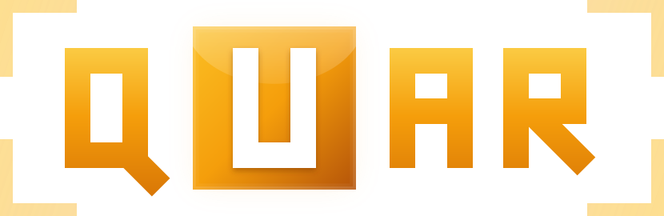

<p align="center">
  
</p>

<h3 align="center">Professional Web-Based Digital Illustration</h3>

<p align="center">
  A fully client-side painting and illustration app built with PixiJS v8, React, and TypeScript.<br/>
  WebGPU-first rendering. No backend required.
</p>

<p align="center">
  
  
  
  
  
</p>

> **In development.** Painting, layers and PNG/JPEG export work, but projects aren't saved between sessions yet. See [Status](#status) and the [completion plan](docs/completion-plan.md).

---

## Features

### Brush Engine
- **Stamp-based rendering** — smooth strokes via Catmull-Rom spline interpolation
- **12 brush presets** across 5 categories: Draw, Paint, Sketch, Blend, Utility
- **Procedural textures** — 12 shape textures + 4 grain textures are generated, but strokes don't use them yet: every brush stamps a round tip
- **Pressure sensitivity** — opacity and size respond to pen pressure (tilt isn't used yet)
- **Configurable smoothing** — per-brush stroke smoothing with exponential filter

### Layers
- Up to 20 layers with full compositing pipeline
- 26 blend modes (Hue and Dissolve still draw as Normal)
- Per-layer opacity, visibility, lock, alpha lock, and clipping masks
- Drag-and-drop reorder, duplicate, merge down
- Live thumbnail previews

### Color
- HSB color disc with classic picker
- Color harmony modes (complementary, analogous, triadic, split-complementary, tetradic)
- Custom palettes with CRUD operations
- Recent colors history
- Swap primary/secondary (X key)

### Selection & Transform
- Rectangle, ellipse, freehand lasso, and magic wand selection tools
- Selection modes: new, add, subtract, intersect (via Shift/Alt modifiers)
- Magic wand tolerance control (the Feather slider isn't connected yet)
- Marching ants animation overlay

### Canvas Navigation
- Two-canvas architecture: PixiJS static canvas + HTML overlay
- Pinch-zoom, two-finger rotate, pan (Space+drag)
- Ctrl+wheel zoom, Shift+wheel horizontal scroll
- Coalesced pointer events, so fast pen strokes keep every sample

### Export & Persistence
- **PNG** export — full-resolution composite
- **JPEG** export — with quality slider (Low/Medium/High/Max)
- **PSD** and **.qart** (ZIP archive with a manifest and per-layer pixel data): the writers exist but aren't connected to the Export dialog yet
- **Saving:** auto-save, Ctrl+S and the Gallery are not connected yet, so a project lasts only until the page closes

### Undo/Redo
- Full-layer snapshot undo with 50-state history
- Supports both layer (stroke) and selection undo entries; deleting, merging and reordering layers can't be undone yet
- Keyboard shortcuts: Ctrl+Z / Ctrl+Shift+Z / Ctrl+Y

---

## Tech Stack

| Layer | Technology |
|-------|-----------|
| **Rendering** | PixiJS v8 (WebGPU primary, WebGL 2.0 fallback) |
| **UI** | React 19 + TypeScript (strict) |
| **State** | Zustand |
| **Build** | Vite 7 |
| **Persistence** | IndexedDB via [idb](https://github.com/jakearchibald/idb) |
| **PSD I/O** | ag-psd |
| **Archive** | JSZip |
| **Icons** | Lucide React |
| **DnD** | @dnd-kit |
| **Tests** | Vitest + Testing Library |

---

## Getting Started

```bash
# Install dependencies
npm install

# Start dev server
npm run dev

# Run unit tests
npm test

# Run a single test file
npx vitest run src/engine/brush/BrushEngine.test.ts

# Type check, lint, unit tests and production build in one go
npm run verify

# End-to-end and real-GPU pixel tests in Chromium, Firefox and WebKit
# (first run: npx playwright install)
npm run e2e
npm run e2e:gpu      # only the GPU pixel tests
npm run e2e:webgpu   # the GPU pixel tests on WebGPU in Chromium

# Build for production
npm run build
```

---

## Architecture

```
src/
├── engine/            # Imperative rendering engine (no React imports)
│   ├── brush/         # BrushEngine, StrokeSmoother, PathInterpolator, BrushTextureManager
│   ├── canvas/        # CanvasManager (orchestrator), ViewTransform
│   ├── input/         # InputManager (pointer, gesture, keyboard)
│   ├── layers/        # LayerManager, LayerCompositor, TileManager
│   ├── selection/     # SelectionManager, SelectionController, tool implementations
│   ├── transform/     # TransformManager, TransformController
│   ├── shaders/       # CPU blend modes, GLSL ES 3.0 + WGSL filter shaders
│   ├── undo/          # UndoManager (layer + selection entries)
│   └── renderer.ts    # PixiJS init (WebGPU → WebGL fallback)
├── components/        # React UI components
│   ├── shell/         # TitleBar, ToolBar, BrushControls, CanvasViewport
│   ├── layers/        # LayersPanel, LayerRow (sortable)
│   ├── color/         # ColorPanel, ColorDisc, ClassicPicker, Harmony, Palettes
│   ├── gallery/       # GalleryView, ProjectCard
│   └── dialogs/       # NewProjectDialog, ExportDialog
├── stores/            # Zustand stores (tool, brush, color, layer, ui, selection, project)
├── db/                # IndexedDB schema via idb
├── io/                # File I/O and persistence
│   ├── persistence/   # MetadataDB, AutoSave
│   └── formats/       # .qart (ZIP), PSD (ag-psd), PNG/JPEG
├── hooks/             # useEngine (React↔Engine bridge)
├── types/             # TypeScript type definitions
└── styles/            # Global CSS tokens and design system
```

**Key architectural rule:** `src/engine/` has zero React imports. The engine is pure imperative code. React communicates with the engine through Zustand stores and callback subscriptions.

---

## Design System

**Neo-Industrial Studio** — warm amber accents on dark charcoal with glass panel effects.

- **Accent:** `#F59E0B` (amber)
- **Background:** `#0a0a0b` (warm charcoal)
- **Glass:** Frosted glass panels with `backdrop-filter: blur(12px)`
- **Typography:** DM Sans (UI) + IBM Plex Mono (values)
- **Icons:** Lucide React, stroke 1.5px

---

## Keyboard Shortcuts

| Shortcut | Action |
|----------|--------|
| Ctrl+Z | Undo |
| Ctrl+Shift+Z / Ctrl+Y | Redo |
| Ctrl+S | Save (not connected yet) |
| Ctrl+A | Select All |
| Ctrl+D | Deselect |
| Ctrl+Shift+I | Invert Selection |
| X | Swap Colors |
| Space+Drag | Pan Canvas |
| Ctrl+Wheel | Zoom |
| Shift+Wheel | Horizontal Scroll |

---

## Status

QUAR Artist is not ready for real work yet. The remaining work for the MVP and v1.0 is planned in [docs/completion-plan.md](docs/completion-plan.md), which also lists every known bug (Appendix A) with the work package that fixes it.

| Area | Where it stands |
|------|-----------------|
| Painting | Works: 12 brush presets, pressure, smoothing. Every brush stamps a plain round tip, strokes end up to one stamp short of where the pen lifts, and opacity builds up like flow (M3) |
| Pen and touch | Pressure, pinch-zoom, two-finger rotate and pan work. The first finger of a pinch leaves a dab, and there's no palm rejection (M3.1, M3.2) |
| Layers | Works: up to 20 layers, opacity, visibility, lock, reorder, duplicate, merge down. Clipping masks and alpha lock follow only the red channel, Merge Down ignores blend modes, and deleting, merging or reordering layers can't be undone (M2, M3) |
| Blend modes | 24 of 26 match the reference over opaque layers. Hue and Dissolve draw as Normal, and most modes are wrong over transparent areas (M2.4) |
| Colour | Works: colour disc, harmonies, palettes, recent colours. Palettes aren't saved yet (M1.9) |
| Selection and transform | The tools work, but brush strokes and transforms ignore the selection, Feather does nothing, and transform handles misbehave after a rotation (M4.1–M4.3) |
| Filters | Gaussian blur, sharpen, HSB adjustment, curves. Strokes made while a filter dialog is open are lost (M4.10) |
| Saving | Projects save themselves in the browser a few seconds after each change, and when you go back to the Gallery or press Ctrl+S. The Gallery lists them with thumbnails, stacks, sorting, rename, duplicate, delete with undo, and import of .qart files and images. Saves still write whole layers and can lose the last few seconds if the tab is closed (M1.2, M1.3) |
| Export | PNG and JPEG work. PSD and .qart aren't connected yet (M1.6, M1.7) |
| Rendering | WebGPU, or WebGL 2 where WebGPU isn't available |
| Tests | Vitest unit tests, plus Playwright end-to-end and real-GPU pixel tests in Chromium (WebGPU and WebGL 2), Firefox and WebKit |

---

## License

Part of the [QUAR Suite](https://quar.pro) by FunwayHQ.
