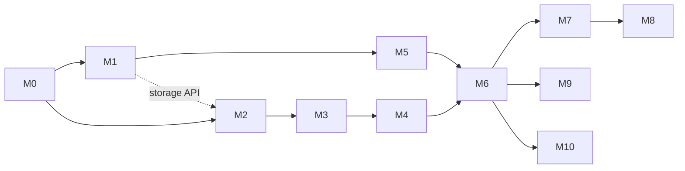

# QUAR Artist — Completion Plan

> **Status:** Draft v1 for review · 2026-11-16
> **Scope:** Everything. That means fixing every finding from the 2026-11-16 code review, finishing the PRD's MVP (Phase 1) and v1.0 (Phase 2), and adding the extra features recommended in the review. Phase 3 (v2.0) stays out of scope (Appendix C).
> **Sources:** `Quar_Artist_PRD_v1.0 (1).md`, `sprints/sprint-plan.md`, `quar-suite-design-prompt.md`, and the code review (Appendix A).
> **Relation to the sprint plan:** this plan replaces the status claims in `sprints/sprint-plan.md`, which marks Sprints 1–11 and 15 as done. The per-sprint prompts there are still useful as feature references.

## Contents

1. [Baseline](#1-baseline-2026-11-16)
2. [Goals and definition of done](#2-goals-and-definition-of-done)
3. [Working principles](#3-working-principles)
4. [Architecture decisions](#4-architecture-decisions)
5. [Roadmap overview](#5-roadmap-overview)
6. [Milestones and work packages](#6-milestones-and-work-packages)
7. [Testing strategy](#7-testing-strategy)
8. [Performance and memory budgets](#8-performance-and-memory-budgets)
9. [Risks](#9-risks)
10. [Open decisions](#10-open-decisions)
- [Appendix A — Findings register](#appendix-a--findings-register)
- [Appendix B — PRD traceability](#appendix-b--prd-traceability)
- [Appendix C — Out of scope](#appendix-c--out-of-scope)

---

## 1. Baseline (2026-11-16)

| Check | Result |
|---|---|
| `npm run build` | **Fails** with 50 TypeScript errors: 25 unused symbols, 23 type mismatches (11 from TypeScript 5.9's stricter typed-array types, 6 from PixiJS's `BLEND_MODES` type, 6 others) and 2 `erasableSyntaxOnly` errors. 15 of the 50 are in test files |
| `npm run lint` | 84 errors in 35 files: 35 `no-explicit-any`, 29 unused variables, 13 `eslint-disable` comments naming rules of an accessibility plugin that isn't installed, 7 React hooks rules |
| Unit tests | 1,150 of 1,151 pass; `TitleBar.test.tsx › shows project name` fails. Rendering tests mock PixiJS, so no test draws a pixel |
| End-to-end tests | 10 Playwright smoke tests, Chromium only, with no pixel or visual assertions |
| Initial download | About 276 KB of gzipped JavaScript against a 200 KB target: PixiJS 137 KB plus an app chunk of 132 KB |
| Continuous integration | None |
| Code size | About 19,100 lines of TypeScript outside tests; `engine/canvas/CanvasManager.ts` alone is 1,670 lines |

**Verdict:** the MVP is not complete.
- Nothing is saved or loaded.
- Blending, clipping and alpha-lock output is wrong.
- The brush engine ignores most brush parameters.
- The PRD's core architecture is not built: tile-based layers, tile-based undo, OPFS, workers and WASM.
- Sprints 12–14 (animation, collaboration, plugins) were never started.

**Good foundations to keep:**
- The engine has no React imports.
- The pure-math modules are clean and tested: smoothing, Catmull-Rom interpolation, pressure curves, symmetry and colour conversion.
- Dialogs are lazy-loaded.
- Design tokens and fonts match the design system.

## 2. Goals and definition of done

**MVP (end of M6).** The PRD 7.1 goal works end to end in Chrome, Edge, Firefox, Safari and iPad Safari. A user can:
- create a canvas and paint with 10–15 quality brushes using a stylus or mouse;
- manage layers and pick colours;
- select and transform;
- export PNG, JPEG, TIFF, PSD and .qart;
- never lose work.

The PRD 10.1 technical metrics are met: latency, compositing time, PSD fidelity and the browser matrix.

**v1.0 (end of M10).** Every item in PRD 7.2, plus the v1.0-tagged rows of PRD section 4, plus the extra features listed in Appendix B.

**A work package is done when:**
1. The behaviour is implemented, including error paths, and works on both WebGPU and WebGL 2.
2. It is tested:
   - unit tests cover the logic;
   - real-GPU harness tests (§7) cover anything that produces pixels;
   - each user flow has an end-to-end test;
   - every bug fix starts with a failing test.
3. Build, lint, unit tests, end-to-end tests and the bundle-size budget pass locally (`npm run verify`; there is no GitHub CI, see Q11).
4. The budgets in §8 still hold.
5. The docs are updated and the matching rows in Appendix A and B are ticked.

## 3. Working principles

1. **Data safety first.** Never destroy data before its replacement is confirmed (resize, save, merge, import). Every destructive action can be undone or asks for confirmation.
2. **Test with real pixels.** Rendering is tested in a real browser and compared with CPU reference implementations, never against a mocked PixiJS.
3. **One alpha convention.** Inside the engine and in storage, colour is always premultiplied RGBA. Straight alpha appears only at import and export, and is converted in one place.
4. **Keep the main thread free.**
   - No main-thread task runs longer than 50 ms.
   - Pixel readbacks are asynchronous.
   - Compression, fills and file encoding and decoding run in workers, using WASM where it pays off.
5. **The engine stays imperative and free of React.** The UI talks to it through a typed facade and a single command registry (D10).
6. **Every milestone ships.** `main` stays releasable. Large rewrites land behind an interface; engine v2 sits behind `?engine=v2` until it replaces v1.
7. **Fix forward toward the target architecture.** Use stopgaps only when they're cheap and the real fix is more than a milestone away.

## 4. Architecture decisions

| ID | Decision |
|---|---|
| D1 | **Sparse tile layers.** A layer is a map of 256×256 tiles (premultiplied RGBA8). • Empty tiles are not allocated; one shared empty tile stands in for them. • Tiles are reference-counted and stop changing once history refers to them; painting on such a tile makes a copy first. • The same tile model serves rendering, undo, autosave, .qart and collaboration. |
| D2 | **GPU tile pool with residency management** (the PRD's "virtual layer paging"). • Tiles live in a pool of 256² textures; move to larger shared textures (atlases) only if profiling shows draw-call overhead. • An LRU manager keeps active and recently used tiles on the GPU and holds the rest compressed in CPU memory. • Under memory pressure it spills tiles to OPFS. Memory budgets depend on the device class. |
| D3 | **Asynchronous raw readback.** Replace `extract.pixels` with backend-specific readback. • WebGL 2: a pixel buffer plus a fence. • WebGPU: `copyTextureToBuffer` plus `mapAsync`. Both return premultiplied bytes. This removes the colour mismatch between WebGL and WebGPU and the main-thread stalls. |
| D4 | **Shader compositor.** • Layers are composited tile by tile into a tiled composite cache. • One blend shader, written in both GLSL ES 3.0 and WGSL, implements all 26 PRD modes with the W3C compositing formulas over any backdrop alpha. • The same shader also handles clipping (using the base layer's alpha), layer masks, group isolation and pass-through. • Separate caches for everything below and above the active layer keep painting cost constant. • This replaces the PixiJS blend modes, its sprite masks and the CPU blend path. |
| D5 | **Stroke-buffer brush model.** • Brush stamps are drawn, with flow, into a per-stroke buffer: `rgba16float` where the GPU can render to it, otherwise `rgba8` with dithering. • While painting, the compositor shows the layer plus the buffer scaled by opacity. At stroke end the buffer is merged into the layer's tiles. • The merge shader applies the eraser, alpha lock and the selection mask. • Result: opacity and flow behave correctly, alpha lock is cheap, and painting respects the selection. |
| D6 | **History made of commands that reference tiles.** • Every user-visible change is a command that stores before/after tile references plus metadata; no full-layer copies. • Undo and redo steps run one at a time, never in parallel. • A memory budget compresses older entries in CPU memory and then spills them to OPFS. • Default depth: 200 steps on desktop, 100 on mobile. |
| D7 | **Storage.** • IndexedDB, through `idb` (see Q1), holds the project list, metadata, settings, presets, palettes and file handles. • OPFS holds tiles, undo spill and timelapse data, written from a persistence worker using sync access handles. • Commits are atomic: write the new tiles, write `manifest-<seq>.json`, switch the current-manifest pointer in an IndexedDB transaction, then delete files nothing refers to. • Where OPFS is unavailable, tiles are stored as IndexedDB blobs. |
| D8 | **Workers and a Rust/WASM core.** • A pool of compute workers hosts `wasm/quar-core`, built with Rust and wasm-bindgen; rustc 1.91 and wasm-pack 0.13 are already installed. • It provides the LZ4 tile codec, span-based flood fill, magic wand, mask feather/grow/shrink, selection boundary tracing, premultiply conversion, and helpers for packing PSD and .qart files. • Every WASM function has a JavaScript fallback and a parity test. |
| D9 | **Split `CanvasManager` into:** • `Engine` (facade) • `DocumentModel` • `Compositor` • `ToolRouter` with one controller per tool, each with explicit begin/commit/cancel states • `ViewController` with the overlay • `HistoryManager` • `IoBridge` |
| D10 | **Command registry.** One registry of commands, each with an id, label, default shortcut, `enabled()` and `run(args)`. It drives menus, rebindable shortcuts, the QuickMenu, context menus, undo-history labels, plugin actions and the collaboration operation log. |
| D11 | **Input router.** A state machine per pointer, with separate policies for pen, touch and mouse, plus gesture recognition and hover. It doesn't depend on which tool is active. |
| D12 | **Unique, stable ids.** `crypto.randomUUID()` for projects, layers, tiles and commands. This replaces the per-session counter that restarts at `layer_1` on every page load. |

## 5. Roadmap overview

| # | Milestone | Outcome | Depends on | Engineer-weeks\* |
|---|---|---|---|---|
| M0 | Safety net and stopgaps | Green build and a local verify script; real-GPU test harness; engine lifecycle fixed; worst visible bugs patched | — | 3–5 |
| M1 | Never lose work | Save and load, gallery, project lifecycle, every export format, opening and saving files on disk, saved settings, version history | M0 | 7–10 |
| M2 | Engine core v2 | Tiles, shader compositor (26 modes), command-based undo (200 steps), workers and WASM, split engine, command registry | M0; M1's storage API | 11–18 |
| M3 | Input and brushes v2 | Correct pen, touch and gesture handling; textured brushes with dynamics and correct opacity; smudge; 15+ brushes; latency targets met | M2 | 9–15 |
| M4 | Selection, transform and tools | Fast, correct selections and transforms; fill, eyedropper, canvas operations, guides, QuickShape, crop, gradient, clipboard; MVP filters on engine v2 | M2 (and M3 for brush-based tools) | 8–13 |
| M5 | Shell, layout and UX | Design-system layout; tablet and phone layouts; keyboard and accessibility; feedback states; undo history panel; reference window | M0 (runs alongside M2–M4) | 4–7 |
| M6 | MVP release gate | Performance targets, installable offline app, bundle under 200 KB, cross-browser test runs, iPad hardening, MVP acceptance | M1–M5 | 3–6 |
| M7 | v1.0 creative features | Layer groups and masks, full filter suite, Display P3 colour, .qbrush and .abr, editable text, QuickMenu, timelapse, PDF and SVG, tablet extras | M6 | 8–14 |
| M8 | Animation Assist | Frames, onion skin, timeline, playback, GIF/MP4/PNG-sequence export | M7.1 | 2–4 |
| M9 | Plugin API v1 | Sandboxed brush, filter, panel and action plugins; plugin manager; sample plugins | M2.9, M6 | 2–4 |
| M10 | Collaboration and cloud | Relay server, Yjs sync, presence, layer locking, offline merge, cloud save and share links | M2, M6, decision Q6 | 5–10 |

\* Rough estimates for one experienced engineer, for sequencing only. The total is about 62–106 engineer-weeks. AI-assisted implementation shortens coding time, but device testing, artist feedback and code review shorten far less.

After M0 the work splits into two tracks that can run in parallel and meet at M6:
- **Engine track:** M2 → M3 → M4.
- **Product track:** M1 → M5.

**Immediate next steps:** M0 is done (M0.2 skipped). Next is M1, starting with M1.1.

---

## 6. Milestones and work packages

**How to read this section:**
- Each work package line shows its size, then the findings it fixes ("fixes F…" refers to Appendix A).
- Sizes: **S** ≤ 2 days · **M** ≤ 1 week · **L** 1–2 weeks · **XL** more than 2 weeks.
- File paths are relative to `src/` unless they start with a top-level folder.

### M0 — Safety net and stopgaps

**Exit criteria:**
- Build, lint and tests pass locally with `npm run verify`.
- The GPU test harness runs, with the known bugs recorded as expected failures.
- Going to the Gallery and back, and React StrictMode, no longer break the engine.
- Every blend mode except Hue renders correctly.

- [x] **M0.1 Green build** · M · fixes F77
  - Fix the 50 TypeScript errors:
    - TypeScript 5.9 typed-array typing: views typed `ArrayBufferLike` passed to `new ImageData()` in CanvasManager, LayerCompositor, LayerManager, FilterManager and TimelapseRecorder. Fixed with the new helper `utils/typedArrays.ts`.
    - The PixiJS `BLEND_MODES` typing in LayerCompositor.
    - `BlobPart` and `ArrayBuffer` typing in `engine/undo/compression.ts` and `io/persistence/AutoSave.ts`.
    - ag-psd types in `io/formats/psd/PsdExporter.ts`.
    - `stores/projectStore.ts:28` is missing `setLastSaved`.
    - `App.tsx:704` accesses the private `layers` field.
    - `erasableSyntaxOnly` violations in `TimelapseRecorder.test.ts`.
    - Unused symbols.
  - Fix the 84 ESLint errors: real types instead of `any`, remove unused code, and fix the accessibility issues. Review each React hooks hit (`set-state-in-effect`, `refs`, `immutability`) one by one, because they can hide real bugs.
  - Fix the failing `TitleBar.test.tsx › shows project name`.
  - Add `npm run verify`, which runs type check, lint, unit tests and build in one command.
  - Done when `npm run verify` passes.
  - **Done 2026-11-16.** Notes:
    - `any` stays banned in app code. Test files may use it for test doubles (ESLint override).
    - Parameters and caught errors that start with `_` count as intentionally unused, as in TypeScript.
    - The 13 `jsx-a11y` comments were removed because that plugin was never installed. Adding it moves to M5.3.
    - The hooks fixes are behaviour-preserving: the guide sync moved into `CanvasManager.applyGuideSettings`, the title bar keeps the menu anchor in state, and Canvas Size resets through a keyed remount.
    - Fixing the guide sync revealed one more hooks error that the React Compiler had been masking: the Google Fonts consent check now runs in a lazy `useState` initializer.
- [x] ~~**M0.2 Continuous integration**~~ · **Skipped** (decision 2026-11-16: no automated checks on GitHub)
  - Replaced by the local `npm run verify` script from M0.1, run before every commit.
- [x] **M0.3 Real-GPU test harness** · L · fixes F76
  - Add `e2e/harness/`: a test page that boots the real engine (no mocks) and exposes `window.__quar` for scripted actions:
    - create a document and set layer properties;
    - draw strokes with a seeded random generator;
    - fill and select;
    - read back the pixels of a layer or of the composite.
  - Write CPU reference implementations to compare against, with tolerances: W3C compositing, alpha lock, clipping and stroke opacity.
  - Run on WebGL 2 in headless Chromium, Firefox and WebKit. Also run on WebGPU in Chromium where the machine supports it, behind a flag.
  - Record each known bug as an expected failure (`test.fail`). Each fix then turns its test green. Cases to cover:
    - blend modes over opaque and over transparent backdrops;
    - clipping on content that isn't red;
    - alpha lock;
    - exported colours on WebGL;
    - stroke opacity limit;
    - undo after Merge Down.
  - Strengthen the smoke tests: wait until the engine is actually ready, then check pixels after drawing a stroke and after undo.
  - **Done 2026-11-16.** Notes:
    - Run the GPU tests with `npm run e2e:gpu` (WebGL 2 in Chromium, Firefox and WebKit) or `npm run e2e:webgpu` (WebGPU in Chromium; skipped when the machine has no adapter). `npm run e2e` adds the app tests; with `QUAR_WEBGPU=1` it covers all four configurations in about 6 minutes. It isn't part of `npm run verify`: run it before committing a package that changes rendering or engine start-up.
    - The harness page is `e2e/harness/index.html?w=64&h=64&renderer=webgl`. Tests use the `quar` fixture (`e2e/support/quar.ts`), compare against `e2e/reference/`, and declare open bugs with `expectKnownBug` (`e2e/support/knownBugs.ts`). When a fix lands, its test passes unexpectedly, which fails the run until the marker is removed.
    - Chromium runs as the full browser (`channel: 'chromium'`). Playwright's default headless shell only has the SwiftShader software GPU, where PixiJS's WebGPU renderer draws nothing.
    - All four configurations give the same results except for F07: on WebGL 2, undo, redo and PNG export darken semi-transparent pixels, while WebGPU is exact. F07 turned out wider than the review found, so M0.5 now fixes it at the readback.
    - 13 blend modes render as Normal (F15). Multiply and the 7 CPU modes are wrong over transparency (F16).
    - The canvas container exposes the backend as `data-renderer`, so app tests can declare backend-specific bugs.
    - New findings: F100 (alpha lock makes semi-transparent pixels opaque) and F101 (strokes end before the pen-up point). F60 now has a reproducible test (`e2e/lifecycle.spec.ts`). Until M0.4 fixes it, it also breaks about half of the app tests on Chromium, where WebGPU starts slowly enough for the discarded engine to report ready first.
    - `npm run verify` also type-checks `e2e/` and `playwright.config.ts` (`tsconfig.e2e.json`).
- [x] **M0.4 Engine lifecycle and error handling** · M · fixes F02, F60, F61, F102
  - `useEngine` attaches through a callback ref, so a newly mounted canvas container gets the engine again.
  - Asynchronous initialisation can be cancelled.
  - If `CanvasManager.init` is cancelled midway, it destroys the PixiJS application it created.
  - The engine survives React StrictMode's double mount.
  - Add a root error boundary that tries to save and then offers a reload.
  - If the engine can't start, show a screen explaining the WebGPU or WebGL 2 requirement.
  - Show a toast for unhandled promise rejections.
  - **Done 2026-11-16.** Notes:
    - `useEngine()` returns a callback ref. Each mounted canvas container gets its own engine, which is destroyed with the container. An engine replaced before it finished starting never reports ready, and its errors are ignored.
    - Under StrictMode the callback ref means only one engine starts. The e2e test for F60 (`e2e/lifecycle.spec.ts`) now passes, and the Chromium smoke tests no longer lose input.
    - Gallery › New Project › canvas now gives a working canvas. Leaving the canvas view discards the open document until M1.1 saves it first; before, the document stayed in memory behind a dead canvas.
    - `CanvasManager.init` destroys the PixiJS application it created when `destroy()` ran during start-up.
    - Testing the failure screen found F102: with no usable WebGL, PixiJS 8 quietly falls back to its Canvas 2D renderer, and the app reported that as WebGL 2. `createRenderer` now rejects Canvas 2D and WebGL 1, so those browsers get the failure screen.
    - The root error boundary offers Retry and Reload. Saving first needs persistence, so that step moves to M1.3.
    - Unhandled promise rejections and exceptions thrown outside React show an error toast. A message that repeats within 5 s is shown once.
- [x] **M0.5 Stopgap fixes** · S · fixes F15 (partly), F49, F56, F104, F07 (readback part)
  - Add `import 'pixi.js/advanced-blend-modes'`. This fixes 12 of the 13 modes that currently render as Normal. Hue stays Normal until M2.4 and is labelled that way in the blend menu.
  - Only the primary button or pen contact paints; right-click and middle-click never do.
  - A pen pressure of 0 stays 0; only the mouse defaults to 0.5.
  - Convert WebGL readbacks (premultiplied) to straight alpha in one shared readback helper, and use it for every `extract.pixels` call: export, thumbnails, timelapse, undo and redo snapshots, flood fill, filters, transforms, the eyedropper, the magic wand and CPU blending. WebGPU readbacks are already straight.
  - Remove the `expectKnownBug` calls these fixes resolve: F07 on WebGL, and F15 for the 12 modes that `advanced-blend-modes` adds. Re-run the blend tests over transparency and move any mode that still fails there to F16 (M2.4).
  - **Done 2026-11-16.** Notes:
    - `engine/layers/blendModes.ts` registers PixiJS's advanced blend modes. On WebGL that alone changed nothing: PixiJS skips blend filters unless the renderer is created with `useBackBuffer: true`, even for layers drawn into render textures. `createRenderer` now sets it, at the cost of one screen-sized texture and a copy per frame.
    - The 12 modes now match the reference over an opaque backdrop in all four configurations. Soft Light was still wrong on WebGPU: PixiJS's WGSL passes the two halves of the formula to `select` in the wrong order (F104, found here). `blendModes.ts` registers a corrected Soft Light in its place until M2.4.
    - Over transparent and semi-transparent backdrops, PixiJS's formulas blend with black or with the premultiplied colour. Only Exclusion comes out right, because its formula is linear in the backdrop. The other 11 are now marked F16 (M2.4), alongside Multiply and the CPU modes.
    - Hue and Dissolve still render as Normal. The blend menu shows "as Normal" next to both, with a tooltip.
    - A stroke, pan or gesture only starts on `button === 0`, so right- and middle-button drags no longer paint. The pen's barrel button and eraser tip do nothing until M3.1 recognises them.
    - Pens keep their pressure, 0 included, so a stroke tapers where the pen lifts instead of ending in a blob. Mice, and touch without pressure sensing, still paint at 0.5.
    - `engine/utils/readback.ts` returns straight alpha on both backends, and every readback goes through it: undo and redo snapshots, export, thumbnails, timelapse, flood fill, filters, transforms, the eyedropper, the magic wand and CPU blending.
    - F07 is fixed on Chromium and WebKit. On Firefox, semi-transparent colours still shift slightly, because its 2D canvas rounds premultiplied colour up and undo, redo and export all pass through one (F103, found here; M1.8 and M2.2). Measured: +2 levels per undo at 50% alpha, +4 in an exported PNG at 25% alpha.
    - The harness decodes exported PNGs in Node instead of through a 2D canvas, so the export tests check the file to within 1 level. Known-bug markers can also be limited to particular browsers.
    - New e2e tests: right- and middle-button drags don't paint; a pen lifting to zero pressure tapers the stroke.
- [x] **M0.6 Housekeeping** · S · fixes F55, F62, F80, F98, F11 (colliding ids)
  - Unique ids for projects and layers (D12).
  - The overlay canvas redraws only when something changed, not on every frame.
  - Remove dead code: `TransformManager.applyToPixels` and `createBlendFilter`.
  - Make the README status table match reality and link to this plan.
  - **Done 2026-11-16.** Notes:
    - Projects and layers get UUIDs from `utils/id.ts` (D12). `crypto.randomUUID` only exists in secure contexts, so `createId` falls back to `crypto.getRandomValues` elsewhere, for example on the dev server opened from a tablet over plain HTTP.
    - Layer ids no longer restart at `layer_1` on every page load (F98). The .qart writer names each layer's file after its id, so two layers can no longer end up in one file (the colliding-ids part of F11).
    - The IndexedDB schema is now version 2: projects are keyed by their UUID instead of an auto-incremented number. Upgrading from version 1 gives each project a UUID and points its layers and tiles at it. Layers and tiles whose project no longer exists are dropped. Unit tests run the upgrade on a version 1 database.
    - The overlay is drawn on demand (F62). `CanvasManager.requestOverlayRender()` draws it once on the next frame, however many times it is called in between. Pointer input, view changes, resizes, tool, guide and selection changes and transforms call it. A shown selection keeps it animating for the marching ants; otherwise an idle canvas no longer redraws 60 times a second.
    - Dead code removed (F55): `TransformManager.applyToPixels` and `bilinearSample`, and `engine/shaders/blend/blendFilters.ts` (`createBlendFilter`) with its HSL helpers. The list of modes the compositor blends on the CPU moved to `cpuBlend.ts` as `CPU_BLEND_MODES`.
    - README (F80): a Status section by area, linked to this plan and its findings, replaces the sprint table. The feature list no longer claims what doesn't work yet: saving, PSD and .qart export, tilt, brush textures, Feather and predicted pointer events. M6.7 rewrites it for the release.

### M1 — Never lose work

**Exit criteria:**
- After killing the tab mid-session and reopening it, at most the last 2 seconds of work are lost.
- The Gallery lists projects with thumbnails, and open, duplicate, rename and delete all work.
- A .qart file saves and reopens pixel for pixel.
- Exported PSD files open correctly in Photoshop, GIMP and Krita.
- PNG, JPEG and TIFF colours and DPI are correct on both backends.

- [ ] **M1.1 Project lifecycle and gallery** · L · fixes F01, F03, F04, F95
  - Add a `ProjectService` for create, open, close, rename, delete and duplicate, backed by database records.
  - New Project builds a fresh document (new layers, empty history, new ids) instead of resizing the old one.
  - When projects exist, the app starts in the Gallery (as the PRD specifies), with a "continue last project" option.
  - Gallery features:
    - thumbnails written on each save;
    - stacks (folders, PRD 4.9) and sorting by date or name;
    - inline rename;
    - delete with an undo toast;
    - duplicate;
    - import of .qart, PSD and image files by drag and drop.
  - Going back to the Gallery flushes the save and then closes the document.
  - New Project dialog:
    - enforce the PRD size limits for the device (8192² on desktop, 4096² on mobile);
    - offer DPI presets and a custom value;
    - offer a colour space choice: sRGB now, Display P3 in M7.3.
- [ ] **M1.2 Tile store** · L · fixes F12, F82 (storage part)
  - A storage API that doesn't depend on the engine: `TileStore.put`, `get`, `list`, `deleteLayer` and `commit(manifest)`.
  - The OPFS backend runs in a persistence worker, commits atomically as described in D7, and falls back to IndexedDB.
  - Tile encoding:
    - premultiplied RGBA8;
    - compressed with `CompressionStream('deflate-raw')` for now and LZ4 once M2.6 lands; the manifest records which codec was used;
    - empty tiles are not stored;
    - a per-tile hash lets saves skip tiles that haven't changed.
  - MetadataDB fixes:
    - each update runs in a single transaction;
    - the (project, layer, tile) index becomes unique;
    - delete and duplicate walk the data with cursors instead of loading every tile with `getAll`;
    - handlers for blocked and terminated database connections.
  - Works with today's full-size layer textures by reading back only the changed tiles as small rectangles.
- [ ] **M1.3 Autosave v2** · M · fixes F01, F08, F14
  - Saves are incremental: each operation reports which tiles it changed, and the save reads back only those.
  - Timing and ordering:
    - a save starts 2 s after the last change, and never more than 30 s apart;
    - saves for a project run in a queue that records the project id when the save is queued;
    - a save requested while another is running is queued, never dropped.
  - The title bar shows Saved, Saving… or Error with a Retry button.
  - A full-storage error explains what to do: free space or export a backup.
  - Flush the save when the page is hidden (`visibilitychange`, `pagehide`), when a project closes, and when going to the Gallery.
  - The root error boundary (M0.4) flushes the pending save before it offers Retry and Reload.
  - A `beforeunload` prompt appears only when there are unsaved changes.
  - Storage safety:
    - request persistent storage (`navigator.storage.persist()`) on the first save;
    - show the storage estimate in Settings;
    - recover from crashes when a project opens by detecting a half-written manifest;
    - delete tiles that nothing refers to.
- [ ] **M1.4 Load path** · M
  - Opening a project reads the manifest, creates the layers and streams tiles to the GPU with a progress indicator.
  - It then restores the view, guides, symmetry settings, active layer and document settings.
- [ ] **M1.5 Save to disk and open files** · M · new feature · fixes F01 (Ctrl+S), F14 (file drop)
  - Ctrl+S saves immediately and shows a toast.
  - File › Save as .qart…:
    - uses `showSaveFilePicker` in Chromium-based browsers and remembers the file per project, so later Ctrl+S writes to the same file;
    - falls back to a download in Safari and Firefox.
  - File › Open… opens .qart, PSD and image files using `showOpenFilePicker` or a file input.
  - Dropping any kind of file calls `preventDefault`, so the browser never navigates away.
- [ ] **M1.6 .qart format v1** · M · fixes F05, F10, F11
  - Write `docs/qart-format.md`. The format is a ZIP containing:
    - `manifest.json`: format and app versions, size, DPI, colour space, alpha convention, the layer tree with ids, properties and order, the active layer, guides and a timelapse reference;
    - `tiles/<layerId>/<tx>_<ty>.<codec>`;
    - `thumbnail.png`;
    - optionally `timelapse.webm`.
  - Harden the reader:
    - check numeric bounds and limits on size and layer count;
    - require unique ids and a valid `activeLayerId`;
    - reject unknown format versions;
    - enforce per-entry and total decompressed-size limits before inflating;
    - fuzz-test it with hostile files.
  - Fix the writer:
    - key entries by unique id;
    - write the project name and preserve layer order;
    - run in a worker with streaming ZIP output (fflate, see Q4) so large files don't freeze the UI.
- [ ] **M1.7 PSD export fixes and PSD import** · M · fixes F05, F09, F93 (PSD import)
  - Export:
    - opacity in the 0–1 range;
    - a real composite image;
    - hidden, clipping, blend mode and lock flags, plus DPI;
    - groups and masks once M7.1 lands;
    - runs in a worker.
  - Import with ag-psd's `readPsd`: layers, blend modes, opacity, visibility and clipping. Groups are flattened until M7.1. Size limits apply.
  - Fidelity test: compare our composite with the PSD's embedded composite on a set of test files. The PRD target is at least a 95% match.
- [ ] **M1.8 Image export** · M · fixes F07, F14 (DPI), F94, F103
  - PNG and JPEG use straight alpha from the single conversion point and record DPI (the PNG `pHYs` chunk and the JPEG JFIF density).
  - Encode PNGs from the pixel buffer, not from a 2D canvas, so Firefox's rounding can't shift semi-transparent colours (F103).
  - TIFF export (PRD MVP) uses a small built-in baseline-TIFF writer: 8-bit RGBA, uncompressed or Deflate.
  - Export at scale (new): 25–400% or a target size, with proper resampling.
  - Option to export only the current layer or the selection.
  - The export dialog shows a size estimate, progress, and a toast on success or failure.
- [ ] **M1.9 Saved settings** · S · fixes F14 (presets), F69
  - Store palettes, recent colours, custom and edited brush presets, QuickMenu slots, shortcuts, panel layout and the global pressure curve in a versioned IndexedDB settings store with migrations.
  - Settings can be exported and imported as JSON.
- [ ] **M1.10 Version history** · M · new feature
  - Keep recent manifest snapshots: on open, hourly, and before risky operations such as merge or canvas resize.
  - File › Restore Version… brings one back. Snapshots share tiles, and cleanup leaves tiles that snapshots still use.
  - When storage isn't persistent, remind the user every 7 days to export a .qart backup (Safari's storage eviction, PRD §8 #9).
- [ ] **M1.11 Size and input guards** · S · fixes F06, F13
  - Validate canvas resizes against the device's limits.
  - Never destroy the old layer textures until the new ones are filled.
  - Resize and crop become undoable through M2.5. Until then they ask for confirmation and take a version snapshot first.
  - Check image size before importing:
    - downscale huge images with `createImageBitmap` resize options;
    - refuse anything beyond the device limits with a clear message.

### M2 — Engine core v2

**Exit criteria:**
- 20 layers at 2048² with 30% of their area painted use less than 200 MB of GPU memory.
- All 26 blend modes, clipping and alpha lock match the CPU reference on WebGL 2 and WebGPU.
- Every operation can be undone, with 200 steps fitting in the memory budget.
- Flood fill at 8192² finishes without running out of memory.

**Order:** M2.8 → M2.9 → M2.1 → M2.2 → M2.3 → M2.4 → M2.5. M2.6 and M2.7 run alongside.

- [ ] **M2.8 Split CanvasManager** · L · fixes F36, F37
  - Split it as described in D9, without changing behaviour, under the M0.3 test harness.
  - Each tool controller has explicit begin, commit and cancel. Switching tools or pressing Alt mid-operation then commits or cancels cleanly.
  - Undo or redo during an operation cancels the operation first and undoes exactly one step.
- [ ] **M2.9 Command registry** · M
  - Build the registry described in D10, and move menus, shortcuts and the QuickMenu onto it.
- [ ] **M2.1 Document model** · M · fixes F98
  - Model the layer tree (raster, group and text layers, plus later types), layer properties, tile maps, a tiled selection mask and document settings.
  - Plain TypeScript with no GPU references, fully unit-tested.
- [ ] **M2.2 Tile pool, residency and readback** · XL · fixes F07, F51, F97, F82, F103
  - Implement D2 and D3, with memory budgets per device class.
  - One utility converts between premultiplied and straight alpha.
  - No document-sized 2D canvases anywhere, because of iOS Safari's 16.7-megapixel limit. Uploading straight from buffers also ends F103.
- [ ] **M2.3 Tiled write path** · L
  - `LayerSurface.beginWrite(region)` copies any affected tiles that history still uses, renders with per-tile offsets, and reports changed tiles to the compositor, history and autosave.
- [ ] **M2.4 Shader compositor** · XL · fixes F15–F20, F27
  - Implement D4 with all 26 PRD modes:
    - Normal, Multiply, Darken, Color Burn, Linear Burn, Darker Color;
    - Lighten, Screen, Color Dodge, Add, Lighter Color;
    - Overlay, Soft Light, Hard Light, Vivid Light, Linear Light, Pin Light, Hard Mix;
    - Difference, Exclusion, Subtract, Divide;
    - Hue, Saturation, Color, Luminosity.
  - Also Dissolve, and Pass Through for groups.
  - Clipping uses the base layer's alpha.
    - Decide how clipped layers composite over semi-transparent base pixels: as a group (Photoshop's default: the clipped layers paint onto the base, which keeps its alpha), or each against the whole stack with its opacity scaled by the base alpha. The CPU reference (`e2e/reference/compositing.ts`) does the second today; change it first if M2.4 chooses the group behaviour. The M0.3 tests only use opaque bases, where both give the same result.
  - Merge Down and Flatten reuse the compositor, so the result matches what's on screen.
  - Golden tests compare against the CPU reference on both backends.
  - Remove the CPU blend path and the use of PixiJS blend modes and masks.
- [ ] **M2.5 Command-based undo history** · XL · fixes F25, F26, F28, F37, F50, F70 (undo part)
  - Implement D6. Commands cover:
    - strokes, fill, filters, transforms and clear;
    - layer add, delete, duplicate, reorder, merge, flatten and property changes;
    - selection changes, recorded only when the selection actually changes;
    - canvas resize, crop and rotate.
  - Undo and redo run one step at a time, never in parallel.
  - A memory budget compresses older entries and spills them to OPFS. Default depth: 200 steps on desktop, 100 on mobile.
  - Each command provides a label and memory statistics for the undo history panel (M5.6).
- [ ] **M2.6 Compute workers and WASM core** · L · fixes F31 (engine part), F82
  - Implement D8:
    - build with `wasm-pack --target web` and integrate it with Vite;
    - produce a SIMD build;
    - add a worker pool;
    - provide JavaScript fallbacks, with parity tests and benchmarks.
  - LZ4 replaces Deflate in the tile store. The manifest's codec field keeps older files readable.
- [ ] **M2.7 Memory budgets and layer limits** · M
  - Determine the device class from `navigator.deviceMemory`, the platform and the maximum texture size.
  - Calculate the layer limit from device memory and canvas size (PRD 4.3) and warn before it's reached.
  - Report tile-pool statistics to the performance dashboard.

### M3 — Input and brushes v2

**Exit criteria:**
- Brushes visibly use shape, grain, scatter, rotation, taper and dynamics.
- A stroke at 30% opacity never goes above 30% where it overlaps itself.
- Pen, touch, mouse and trackpad behave as described in M3.1 and M3.2, on iPad and on desktop.
- Latency is under 25 ms on desktop and under 40 ms on iPad (PRD).

- [ ] **M3.1 Pointer router** · L · fixes F56, F57, F58, F59
  - Implement D11. Only primary contact paints.
  - The pen barrel button and the eraser tip (button 5, or `buttons & 32`) are recognised. Flipping to the eraser tip switches to the eraser (PRD MVP).
  - Palm rejection: once a pen has been seen, touch no longer paints. A setting chooses whether touch paints, does gestures only, or is ignored.
  - Lifecycle handling:
    - capture the pointer for the length of a stroke;
    - `pointercancel`, `lostpointercapture` and the window losing focus end or cancel the stroke cleanly;
    - Space-to-pan resets when the window loses focus.
  - Scrolling and zoom:
    - a two-finger trackpad scroll pans;
    - a pinch (Ctrl+wheel, or Safari gesture events) zooms;
    - mouse-wheel behaviour is configurable.
  - Keep coalesced events. Use predicted events only for the live preview, never for the committed stroke. Interpolate on animation frames where coalesced events are missing (Safari).
- [ ] **M3.2 Touch gestures** · M · new feature and PRD 4.2 · fixes F57
  - Pinch, rotate and pan never leave a stray dab: a stroke that has just started is cancelled if a second finger lands soon enough.
  - Two-finger tap undoes and three-finger tap redoes.
  - Four-finger tap hides or shows the UI.
  - Touch-and-hold samples a colour.
  - A three-finger swipe down opens the copy/paste menu.
  - A quick pinch fits the canvas to the screen.
- [ ] **M3.3 Stroke pipeline** · M · fixes F101
  - Smoothing: StreamLine (exponential), rope/lazy-mouse stabilisation and motion filtering (v1.0).
  - Then Catmull-Rom interpolation and pressure-aware spacing.
  - Each stamp's parameters come from pressure, tilt, azimuth, twist and speed, through curves.
  - Each stroke uses a seeded random generator, which collaboration replay needs.
  - The stroke ends exactly at the pen-up point: place a final stamp there (F101).
- [ ] **M3.4 Stamp renderer and stroke buffer** · XL · fixes F20 (alpha lock), F21, F22, F24, F30 (strokes), F100
  - Implement D5. Stamps are batched textured quads using mipmapped shape textures.
  - Grain can follow the stamp ("texturized") or stay fixed to the canvas ("rolling"), with scale, depth and movement settings.
  - Hardness comes from generated shape textures.
  - The merge shader handles opacity, the eraser, alpha lock and the selection mask. No textures are allocated per stroke.
- [ ] **M3.5 Brush parameters and Brush Studio** · XL · fixes F21, F23
  - The engine reads every `BrushPreset` field and gains the PRD's MVP and v1.0 parameter categories:

    | Category | Parameters |
    |---|---|
    | Stroke path | spacing, jitter, fall-off |
    | Taper | pressure taper and touch taper, with size and opacity per end |
    | Shape | scatter; rotation modes, including follow stroke, azimuth and twist; count; random flip |
    | Grain | grain texture settings |
    | Rendering | Light, Uniform, Intense and Heavy glaze; flow; wet edges; burnt edges; per-brush blend mode |
    | Dynamics | speed controls size, opacity and jitter |
    | Colour dynamics | hue/saturation/brightness jitter per stamp or per stroke; secondary colour; pressure and tilt control colour |
    | Properties | orient to screen; size and opacity limits |

  - The Brush Studio preview draws a real stroke with the engine.
  - The Brush tab in the right panel gets its content.
- [ ] **M3.6 Smudge and blur brushes** · L
  - Smudge picks up the colour under each stamp and carries it along, mixed by strength and dilution, on the GPU.
  - Add a blur brush.
  - Both respect alpha lock and the selection.
- [ ] **M3.7 Brush library** · L
  - At least 15 high-quality default brushes: pencils, inks, markers, paints, airbrushes, textures and erasers.
  - Each brush has authored or generated textures in `public/brushes/` and a thumbnail.
  - Run an artist review loop; the PRD's target is a 4/5 rating in a blind test against Procreate.
  - The library grows to 50+ brushes in M7.4.
- [ ] **M3.8 Pressure, hover and tablet** · M · fixes F86
  - Add a global pressure curve, applied before each brush's own curve. A test pad lets users calibrate it (new; PRD 4.11.5).
  - Show the brush outline at the cursor while the pen hovers (`buttons = 0`, PRD MVP).
  - Map pen twist to stamp rotation and add pen-button mapping (PRD v1.0).
- [ ] **M3.9 Latency** · M
  - Measure the time from pointerdown to the pixel appearing on screen.
  - Use predicted events for the preview.
  - Use the desynchronized canvas hint on both backends where supported.
  - Never do a synchronous readback during a stroke.
  - Tests check the PRD latency budgets.

### M4 — Selection, transform and tools

**Exit criteria:**
- Every MVP tool works with selections on both backends.
- Transforms build on earlier drags and respect the selection.
- Fill and magic wand finish within budget at 8192².
- Guides and QuickShape behave as specified.

- [ ] **M4.1 Selection engine v2** · L · fixes F28, F30, F32, F35, F87, F89
  - The selection is a tiled 8-bit mask.
  - Selection tools:
    - rectangle and ellipse;
    - freehand plus polygonal mode with vertex editing (PRD MVP);
    - magic wand in WASM: contiguous or global, sampling one layer or all, with tolerance set by dragging.
  - Modifier keys:
    - while a selection tool is active, the add, subtract and intersect modifiers take priority over Alt for the eyedropper;
    - Shift's "add" and "constrain" meanings are told apart per gesture.
  - Selection commands: real feathering (the mask is blurred), grow and shrink, invert, and selection from layer alpha.
  - Marching ants are drawn from traced outlines as one cached path with a continuous dash, and recomputed only when the selection changes.
- [ ] **M4.2 Selection-aware operations and clipboard** · M · new feature · fixes F30, F84
  - Strokes, fill, filters, clear and transform respect the selection mask, including feathering.
  - Cut, copy and paste (Ctrl+X/C/V):
    - work with the system clipboard, so images move to and from other apps;
    - include copy merged and paste in place.
  - Ctrl+J turns the selection into a new layer.
  - The canvas context menu gets Paste.
- [ ] **M4.3 Transform v2** · XL · fixes F29, F30, F38, F39, F90
  - Selected pixels lift into a floating selection.
  - Drag math:
    - the transform is computed from the state at drag start, so drags build on each other;
    - handles work in the content's own coordinates;
    - scaling is about the opposite handle (Alt scales about the centre);
    - uniform and free scaling can be toggled;
    - rotation snaps every 15°;
    - flip.
  - Interpolation: nearest, bilinear and bicubic in a shader (PRD MVP).
  - PRD v1.0 additions: distort (four corners), perspective, warp (bezier mesh), and snapping to edges, the centre and guides.
  - Commit and cancel behaviour:
    - an undo entry is created only when something actually changed;
    - the layer can't be switched mid-transform;
    - Alt never commits the transform.
- [ ] **M4.4 ColorDrop fill** · M · fixes F31, F91, F97
  - Tile-aware span fill in the WASM worker.
  - Drag to adjust the threshold (PRD MVP).
  - Sample the current layer, all layers or a reference layer.
  - Anti-aliased edges. Respects the selection.
- [ ] **M4.5 Eyedropper** · S · fixes F88
  - Hold Alt to sample, with a magnifier.
  - Use the EyeDropper API to sample outside the canvas where the browser supports it.
  - Sample the current layer or all layers, with correct colours (straight alpha).
- [ ] **M4.6 Canvas operations** · M · new feature (crop) · fixes F06, F40
  - Canvas resize with an anchor point, and image resize with resampling.
  - Crop tool: to the selection, to the content, or with free handles.
  - Rotating 90° swaps width and height; flip the canvas; trim transparent edges.
  - All of these can be undone.
- [ ] **M4.7 New tools** · M · new features
  - Gradient tool:
    - linear or radial;
    - primary-to-secondary colour or from presets;
    - dithered;
    - respects the selection.
  - Lasso fill.
  - Flip or mirror the view without changing the document, and reset view rotation.
- [ ] **M4.8 Guides and drawing assist** · L · fixes F33, F34, F44, F45, F48, F54
  - Symmetry:
    - stored per document, with draggable axes;
    - a rotation toggle for radial symmetry, and mirrored radial (PRD).
  - Perspective:
    - 1-, 2- and 3-point;
    - vanishing points and horizon are draggable and saved to the store;
    - strokes snap to perspective lines (drawing assist).
  - Grids:
    - a correct isometric grid with assisted drawing;
    - grid snapping.
  - Rulers with draggable guide lines (new).
  - Guide handles respond only in guide editing mode, and the overlay follows view rotation.
- [ ] **M4.9 QuickShape v2** · M · fixes F43
  - Detection: corner detection and line fitting, rotated-ellipse fitting, and polygons.
  - Constraints: hold Shift or put down a second finger to get a circle, square or equilateral triangle.
  - Edit nodes after the shape is created.
  - The shape is applied inside the stroke's own command, so nothing can interleave with it.
- [ ] **M4.10 MVP filters on engine v2** · M · fixes F41, F42, F52, F53, F92 (pencil mode)
  - Gaussian blur, Sharpen, HSB and Curves run as GPU passes over tiles. Each tile is processed with a margin from its neighbours, so borders don't fade.
  - Previewing:
    - the preview is throttled and respects the selection mask;
    - the result can be undone;
    - interacting with the canvas cancels the preview cleanly, unless the dialog is made modal;
    - undo is blocked while previewing.
  - Fix the blur filter's resource leak.
  - Pencil mode: paint the filter on with a brush (PRD 4.7, MVP for blur).

### M5 — Shell, layout and UX

**Exit criteria:**
- The layout matches the design spec at 1920×1080, 1024×768, 768×1024 and 390×844 (the Sprint 9 sizes).
- Panels and dialogs can be used with the keyboard alone.
- axe-core accessibility checks pass.
- No shortcut fires behind an open dialog.

- [ ] **M5.1 Layout per the design system** · L · fixes F63, F75, F83, F99
  - Desktop layout:
    - the canvas runs to the window edges;
    - a 48 px tool rail and a right shelf with slide-in panels;
    - glass panel surfaces.
  - Auto-hide by wiring up `useAutoHide`: panels fade to 10% after 3 s and come back on hover or touch.
  - Tab shows or hides the UI. F switches true fullscreen (Fullscreen API) with the HUD.
  - Responsive layouts:
    - breakpoints for desktop, tablet portrait, tablet landscape and phone;
    - on phones, layers, colour and brushes open as bottom sheets;
    - the unused `RightShelf` component gets used;
    - touch targets are large enough.
- [ ] **M5.2 Keyboard** · M · fixes F35, F64, F65, F66
  - Focus rules:
    - workspace shortcuts work unless the user is typing in a text field or a dialog is open;
    - Tab and Enter act on the canvas only when it has focus.
  - Bindings follow spec §11: S, L, W, U, H, Z, R, `{` and `}`, Ctrl+E for Merge Down, T for Text, and the rest.
  - Avoid combinations the browser reserves: Ctrl+N, Ctrl+Shift+N, Ctrl+T and Ctrl+W.
  - Match letters by `code` and symbols by `key`, so Shift+[ works.
  - Shortcuts can be rebound, with conflict detection, and are saved (new feature). The shortcuts dialog shows the current bindings.
- [ ] **M5.3 Dialogs and accessibility** · M · fixes F42, F66, F67, F74, F75
  - A shared Dialog component:
    - keeps focus inside the dialog and sets initial focus;
    - closes on Esc and returns focus when closed;
    - sets `aria-modal`.
  - Esc and Enter inside dropdown menus no longer reach global handlers.
  - Accessibility fixes:
    - the colour disc works with the keyboard and exposes ARIA values;
    - layer rows can take focus and be reordered with the keyboard (dnd-kit `KeyboardSensor`);
    - tooltips also appear on focus.
  - Design-system fixes:
    - support `prefers-reduced-motion`;
    - Lucide icons at 1.5 px stroke and 22 px size;
    - fix the undefined `--color-amber` token.
  - axe-core checks run in Playwright.
  - Add `eslint-plugin-jsx-a11y` (recommended rules). Review the sites whose stale `eslint-disable` comments M0.1 removed:
    - the dialog backdrops (Canvas Size, Drawing Guides, QuickMenu settings, Timelapse export);
    - the blend-mode menu backdrop;
    - the canvas context-menu wrapper in `App.tsx`;
    - the timelapse `<video>` preview, which has no captions.
- [ ] **M5.4 Feedback and states** · S · fixes F70 (toast)
  - Toasts with actions, such as "Layer deleted — Undo".
  - Save status, and progress for open, import and export.
  - Error toasts, empty states, and confirmations for destructive operations.
- [ ] **M5.5 Panel fixes** · M · fixes F68, F70, F71, F73
  - Colour panel:
    - recent colours are added only when a colour is committed;
    - harmony swatches can be clicked;
    - swatches get a context menu instead of being deleted instantly on right-click;
    - palette imports are validated against a schema.
  - Layers panel: a real layer lock, shown in the UI and enforced by the engine, with its own icon separate from alpha lock.
  - Fix dropdown menus reopening, and limit view updates sent to React to one per animation frame.
- [ ] **M5.6 Undo history panel** · S · new feature
  - Lists each command by its label, jumps to any step on click, and shows memory use.
- [ ] **M5.7 Fonts and privacy notice** · S · fixes F72
  - Replace the misleading cookie banner with a notice in the Text tool about loading Google Fonts.
  - Self-host a curated set of fonts so text works offline.
- [ ] **M5.8 Reference window** · M · PRD v1.0 #12 · fixes F93 (reference window)
  - A floating, resizable panel that shows either:
    - a live view of the canvas with its own zoom;
    - an imported reference image with pan, zoom and eyedropper.
  - Its contents are saved per project.

### M6 — MVP release gate (PRD Sprint 9)

**Exit criteria:**
- The PRD 10.1 technical metrics are measured and met.
- The app installs and works offline.
- The initial download is under 200 KB of gzipped JavaScript.
- The Playwright suites pass on Chromium, Firefox and WebKit.
- A manual iPad Safari test pass is recorded.
- The MVP acceptance end-to-end test passes.

- [ ] **M6.1 Performance instrumentation and budgets** · M
  - A developer performance overlay shows latency, compositing time, a GPU memory estimate, tile counts, undo-history memory and save duration.
  - Performance tests, run locally, enforce the thresholds in §8.
- [ ] **M6.2 Bundle size** · M · fixes F78
  - Today's 276 KB is PixiJS (137 KB) plus the app chunk (132 KB). The app chunk also contains react-dom's client code, because `manualChunks` lists only `react-dom`.
  - Measure with rollup-plugin-visualizer.
  - Lazy-load everything the first screen doesn't need: the Gallery when a project opens directly, Brush Studio, guides, filters, text, timelapse and export.
  - Keep ag-psd and the ZIP library lazy once M1 wires them in.
  - Trim PixiJS features we don't use, and fix the react-dom chunking.
  - Add a `size-limit` check to `npm run verify`.
- [ ] **M6.3 Installable, offline app** · M · new feature · fixes F81
  - A web app manifest with icons made from the new logo.
  - A service worker (vite-plugin-pwa / Workbox) that caches the app shell, brush textures and fonts, and shows an "Update available" toast.
  - Users can install the app.
  - Once installed, the OS can open .qart files with it (`file_handlers` and `launchQueue`).
- [ ] **M6.4 Cross-browser and visual regression** · M · fixes F76
  - Playwright projects for Chromium (WebGL and WebGPU), Firefox, WebKit and Edge.
  - Screenshot baselines of the gallery, the canvas with tools, the layers panel, the colour picker and the export dialog.
  - `docs/testing/device-matrix.md` with a manual checklist for iPad and graphics tablets.
- [ ] **M6.5 iPad hardening** · M · fixes F51
  - Tune the residency budgets on real devices.
  - Test 4K documents with 20 layers.
  - Handle the tab being suspended in the background, and prompt for persistent storage.
- [ ] **M6.6 MVP acceptance** · S
  - An end-to-end script that walks through the PRD 7.1 goal.
  - The PSD fidelity check.
  - A beta feedback loop with artists, because the PRD's brush-quality metric needs people.
- [ ] **M6.7 Documentation** · S · fixes F80
  - User guide basics, keyboard reference and tablet setup guide (PRD v1.0).
  - An architecture document for engine v2, and a contributing guide.

### M7 — v1.0 creative features

**Exit criteria:**
- Every PRD 7.2 item except animation (M8), plugins (M9) and collaboration and cloud (M10) is implemented and covered by harness or end-to-end tests.
- PSD files with groups and masks survive a round trip.

- [ ] **M7.1 Layers v1.0** · L
  - Groups: nesting, pass-through, collapse, and group opacity and blend mode.
  - Layer masks, reference layers and background-colour layers.
  - Drag layers into and out of groups.
  - Groups and masks survive a PSD round trip.
- [ ] **M7.2 Filter suite** · XL · fixes F92
  - Filters:
    - motion blur, perspective blur, colour balance;
    - noise (clouds, billows, ridges);
    - gradient map (8 presets plus custom);
    - liquify (push, twirl left and right, pinch, expand);
    - clone tool, chromatic aberration;
    - halftone (3 modes), bloom, glitch (4 modes), recolour.
  - Each filter works on the whole layer or painted on with a brush (pencil mode), with a live preview, the selection mask and undo.
  - Adjust filters by dragging on the canvas.
- [ ] **M7.3 Colour management** · M
  - Display P3 documents: P3 canvases, and a P3 colour picker that warns when a colour is outside sRGB.
  - Exported PNG and JPEG files carry a colour profile.
- [ ] **M7.4 Brush import, export and library** · L
  - `.qbrush` files (JSON plus textures in a ZIP) and brush sets.
  - Photoshop `.abr` import, turning sampled brushes into shape textures.
  - Per-brush blend modes.
  - The library grows to 50+ brushes.
- [ ] **M7.5 Text v1.0** · M · fixes F47
  - Text layers stay editable until rasterised.
  - Local fonts through the Font Access API (Chromium).
  - Properties: family, size, weight, italic, alignment, letter spacing, line spacing and colour.
  - The preview matches the committed text at any zoom.
  - Font loading errors are handled.
- [ ] **M7.6 QuickMenu v1.0** · S · fixes F69, F85
  - A radial menu that opens at the cursor; drag to choose.
  - Eight slots, each bound to any command; long-press opens it on touch.
  - Settings are reachable and saved.
- [ ] **M7.7 Timelapse v1.0** · M · fixes F46, F96
  - Capture a frame at the end of each stroke with `captureStream(0)` and `requestFrame`, so the video's length no longer follows the clock.
  - Letterbox frames to the document's aspect ratio, at 1080p, 2K or 4K.
  - Export a 30-second version or the full recording.
  - Store recording chunks in OPFS and inside .qart, and stop the media tracks when done.
  - MP4 through WebCodecs where supported.
- [ ] **M7.8 PDF and SVG export** · M
  - PDF through pdf-lib: a single page now, and multi-page from animation frames once M8 lands.
  - SVG exports editable text and shape layers as vectors and embeds raster layers.
- [ ] **M7.9 Tablet extras** · S
  - A pen-button mapping screen, options for twist mapping, and an in-app tablet setup guide.

### M8 — Animation Assist (Sprint 12) · fixes F93 (animation)

**Exit criteria:** the Sprint 12 "VERIFY" list passes as end-to-end tests.

- [ ] **M8.1 Animation model and timeline** · L
  - Each top-level group is one frame.
  - A timeline strip shows thumbnails, supports reordering, adding, duplicating and deleting frames, and holding a frame for longer.
  - Arrow keys move between frames.
- [ ] **M8.2 Onion skin and playback** · M
  - Onion skin shows 1–5 frames on each side, tinted, at 60/40/20% opacity, drawn by the compositor.
  - Playback runs at 1–60 FPS, looping, ping-pong or once.
- [ ] **M8.3 Animation export** · M
  - GIF with gifenc in a worker.
  - MP4 and WebM with WebCodecs and a muxer; FFmpeg.wasm only as a lazily loaded fallback (Q5).
  - PNG sequences as a ZIP.
  - Animation settings are saved in .qart, and frames export to PSD as groups.

### M9 — Plugin API v1 (Sprint 14) · fixes F93 (plugins)

**Exit criteria:** the Sprint 14 "VERIFY" list passes, and the security review is done.

- [ ] **M9.1 Runtime and security** · L
  - Plugins ship as `.qplugin` ZIP files with a manifest.
  - Each runs in a sandboxed iframe (`sandbox="allow-scripts"`, opaque origin, content security policy) and talks to the app through typed `postMessage` calls.
  - Plugins declare the permissions they need, and the user confirms them in a consent dialog.
  - A security review is part of this package.
- [ ] **M9.2 Host API** · M
  - Plugins can:
    - read and write canvas pixels (tile-based, with transferable buffers);
    - access layers and colour;
    - run commands;
    - show a panel (`ui.showPanel`) and notifications.
- [ ] **M9.3 Plugin types and manager** · M
  - Four plugin types:
    - brush (custom stamp generation);
    - filter;
    - panel;
    - action.
  - The plugin manager installs plugins from a file, enables and disables them, and shows their settings. Installed plugins are stored in OPFS.
- [ ] **M9.4 Samples and SDK** · S
  - A Pixel Sorter filter and a Color Info panel as sample plugins.
  - A TypeScript typings package and documentation.

### M10 — Collaboration and cloud (Sprint 13 and v1.0 #14) · fixes F93 (collaboration)

**Exit criteria:**
- The Sprint 13 "VERIFY" list passes with two browser contexts.
- A project saved to the cloud reopens correctly from its share link.

Decision Q6 must be made before this milestone starts.

- [ ] **M10.1 Server** · L
  - A `server/` package with a WebSocket relay, one room per project, and a persisted log of updates.
  - Size limits and rate limiting.
  - A Dockerfile and deployment.
- [ ] **M10.2 Shared document** · L
  - A Yjs document holding:
    - the layer tree and layer properties;
    - a log of stroke operations (delta-encoded points, brush parameters and the random seed);
    - presence (each user's cursor, tool, name and colour).
  - Each user has their own undo scope, integrated with M2.5.
- [ ] **M10.3 Sync semantics** · L
  - Your own strokes appear at once; remote strokes are replayed through the local brush engine.
  - By default (Q7), the stroke's author also sends the resulting tiles, which correct any differences between GPUs.
  - A layer is locked while someone paints on it. The lock releases 5 s after that person disconnects.
  - People joining late load a snapshot first.
- [ ] **M10.4 Collaboration UI** · M
  - A Share button and link, and avatars of who's connected.
  - Other users' cursors, the connection status, and lock icons on layers.
  - Follow another user's view.
- [ ] **M10.5 Offline and reconnect** · M
  - Keep the Yjs document locally and merge changes on reconnect.
  - Playwright tests with two browser contexts.
- [ ] **M10.6 Cloud save and share links** · L
  - Upload the .qart to cloud storage, encrypted as decided in Q6.
  - View-only and edit links, a version list, delete, and storage quotas.

---

## 7. Testing strategy

| Layer | Tooling | Covers |
|---|---|---|
| Pure logic | Vitest (jsdom or node) | Document model, undo history, command registry, maths (smoothing, curves, symmetry, homography), file format readers and writers, settings migrations |
| Engine integration | Playwright with the real-GPU harness (M0.3) | Every path that produces pixels, compared with CPU references: blend modes, clipping, masks, alpha lock, stroke opacity and flow, eraser, fill, magic wand, filters, transforms and readback colours. Always on WebGL 2, and on WebGPU where available |
| WASM parity | Vitest and `cargo test` | Each WASM function against its JavaScript fallback, plus benchmarks |
| User flows | Playwright end-to-end | Gallery; new, open, save and close; autosave and crash recovery; exports, downloaded then re-imported and pixel-checked; shortcuts; touch gestures (Chrome DevTools Protocol touch emulation); responsive layouts |
| Visual regression | Playwright screenshots | Key screens in each browser (M6.4) |
| Fuzzing | Vitest property tests | .qart, PSD, palette and plugin-manifest readers given hostile input |
| Performance | Playwright performance suite | The §8 budgets, run locally on Chromium; manual device runs are recorded |
| Accessibility | axe-core in Playwright | Panels and dialogs |

**Rules:**
- Every bug fix starts with a failing test.
- Rendering logic is never tested against a mocked PixiJS. React component tests can keep their mocks.
- Strokes use a seeded random generator so results are reproducible.

## 8. Performance and memory budgets

| Metric | Budget | Source |
|---|---|---|
| Stroke latency, pointer to pixel on screen | Under 25 ms on desktop, under 40 ms on iPad | PRD 10.1 |
| Compositing 20 layers at 2K | Under 16 ms per frame | PRD 10.1 |
| GPU memory for 20 layers at 2048² with 30% painted | Under 200 MB | Sprint 9 |
| Undo history covering 100 operations | Under 100 MB of RAM; anything beyond goes to OPFS | Sprint 9 |
| Main-thread tasks while painting | None longer than 50 ms | §3 |
| Autosave after a typical stroke | Under 100 ms of total main-thread time | This plan |
| Opening a 4K project with 20 layers | Under 3 s to first paint on desktop | This plan |
| Flood fill or magic wand at 4096² | Under 300 ms, using under 50 MB of extra memory | This plan |
| Initial download | Under 200 KB of gzipped JavaScript | Sprint 9 |
| Repeat load from the service worker cache | Under 1 s until usable on desktop | This plan |

## 9. Risks

| Risk | Impact | Mitigation |
|---|---|---|
| The engine v2 rewrite (M2) destabilises the app | High | Split the engine without behaviour changes first, keep harness tests in place, and put v2 behind `?engine=v2` until it matches v1 |
| Rendering differences between WebGL and WebGPU, or between GPU vendors, break the comparison tests | Medium | Per-test tolerances, and separate reference images per backend where needed |
| iPad memory limits | High | Tile residency and memory budgets (M2.2, M2.7), and real-device testing in M6.5 |
| Browser API gaps: File System Access, Font Access and EyeDropper exist only in Chromium-based browsers; OPFS has quirks in Safari | Medium | Every work package that uses these detects them and has a fallback |
| Brush quality is subjective | High | An artist feedback loop from M3.7 onward, with side-by-side comparisons |
| The overall scope (about 62–106 engineer-weeks) | High | Each milestone ships on its own, and the MVP gate (M6) comes before any v1.0 work |
| Server cost and operations for M10 | Medium | Decision Q6; a relay that users can host themselves; end-to-end encryption keeps the server simple |
| Plugin security | Medium | Sandboxed iframes with no origin, a permission model, and a security review in M9.1 |

## 10. Open decisions

These are the defaults I'll use unless you choose otherwise. Nothing here blocks M0.

| # | Question | Default | Needed by |
|---|---|---|---|
| Q1 | The PRD names Dexie, but the code uses `idb` | Keep `idb`: it's already integrated and tested, and Dexie adds nothing we need. Update the PRD and CLAUDE.md | M1.2 |
| Q2 | The PRD names perfect-freehand | Don't adopt it. The stamp-based brush engine already covers pressure-sensitive strokes. Reconsider later for a vector ink brush | M3 |
| Q3 | The PRD names chroma.js | Don't adopt it for v1.0. The existing, tested colour maths plus Display P3 canvases cover what's needed; CMYK and ICC profiles are v2.0 | M7.3 |
| Q4 | Which ZIP library | fflate in workers instead of JSZip: it streams, is faster and is smaller | M1.6 |
| Q5 | How to encode video | WebCodecs with a small MIT-licensed muxer. FFmpeg.wasm (LGPL, about 25 MB) only as a lazily loaded fallback | M7.7 |
| Q6 | Backend for collaboration and cloud save: hosting, accounts or links, encryption | A Node relay users can host themselves, plus S3-compatible storage. No accounts in v1.0: share links carry the access, and content is end-to-end encrypted with the key in the URL fragment | M10 |
| Q7 | Collaboration sync model: the PRD syncs strokes only, never pixels | Replay strokes for responsiveness, and also send the resulting tiles after each stroke, because different GPUs don't render identically | M10 |
| Q8 | PRD conflict: dual brush and CMYK are v1.0 in PRD section 4 but v2.0 in the roadmap | Follow the roadmap: both are v2.0 and out of scope | M7 |
| Q9 | Oldest supported browsers | The current and previous major versions of Chrome, Edge, Firefox and Safari; iPadOS 17 and later | M0 |
| Q10 | Analytics for the PRD's usage metrics (monthly active users and similar) | No analytics in the app for now, since it's a privacy-first local app. Revisit at public beta | M6 |
| Q11 | How work lands | **Decided 2026-11-16:** commits go straight to `main`, one per work package, after `npm run verify` passes. No GitHub CI. Nothing is pushed without your OK | M0 |

---

## Appendix A — Findings register

All findings from the 2026-11-16 code review. Paths are relative to `src/`. Severity: **C** critical · **H** high · **M** medium · **L** low.

| ID | Sev | Finding | Where | Fixed in |
|---|---|---|---|---|
| F01 | C | Nothing is saved or loaded: • AutoSave, the MetadataDB project functions and the .qart and PSD writers are never called • Ctrl+S and File › Save do nothing • there's no warning when leaving the page • rename does nothing | `App.tsx:318`, `App.tsx:644`, `hooks/useKeyboardShortcuts.ts:99`, `components/shell/TitleBar.tsx:53` | M1.1, M1.3, M1.5 |
| F02 | C | Going to the Gallery and back leaves a dead canvas, because the engine stays attached to the removed container | `hooks/useEngine.ts:15-46` | M0.4 |
| F03 | H | The Gallery is always empty. Open, delete, duplicate and rename do nothing, open ignores the project id, and no thumbnails are written | `App.tsx:332`, `App.tsx:614-616` | M1.1 |
| F04 | H | New Project keeps the old layers, pixels and undo history | `App.tsx:318-322` | M1.1 |
| F05 | H | Choosing PSD or .qart export closes the dialog without writing a file | `App.tsx:295-315` | M1.6, M1.7 |
| F06 | H | A typed canvas size beyond the GPU limit wipes every layer, because the old textures are destroyed even when copying failed. Shrinking the canvas crops it with no undo | `components/dialogs/CanvasSizeDialog.tsx:46-50`, `engine/layers/LayerManager.ts:59-73`, `engine/canvas/CanvasManager.ts:340-358` | M1.11, M4.6 |
| F07 | H | WebGL readbacks are premultiplied but treated as straight alpha: • exports darken (50% red becomes dark red) • undo, redo, flood fill, filters and transforms upload the premultiplied data again, so every such edit darkens semi-transparent pixels (measured in M0.3) • thumbnails, timelapse, Curves, CPU blending and tolerances differ between backends | `engine/canvas/CanvasManager.ts:303-326`, `engine/canvas/CanvasManager.ts:728-746`, `engine/brush/BrushEngine.ts:163-175`, `io/formats/image/ImageExporter.ts:25-27` | M0.5, M1.8, M2.2 |
| F08 | H | AutoSave has race conditions: • writes to the wrong project after a switch • drops saves requested during a save • swallows storage-full errors • leaves orphaned tiles • loses the pending save when a project closes | `io/persistence/AutoSave.ts:74-116` | M1.3 |
| F09 | H | PSD export: • passes opacity as 0–255, which ag-psd clamps to 1 • writes a black composite • drops clipping, locks and DPI • runs on the main thread | `io/formats/psd/PsdExporter.ts:23-41` | M1.7 |
| F10 | M | The .qart reader accepts hostile input: infinite sizes, duplicate ids, and unbounded decompression (a 33 KB file inflated to 800 MiB) | `io/formats/qart/manifest.ts:47-76`, `io/formats/qart/QartReader.ts:43-50` | M1.6 |
| F11 | M | The .qart writer stores full uncompressed layers, omits the project name, merges layers whose ids collide, and ignores layer order | `io/formats/qart/QartWriter.ts:33-59` | M0.6, M1.6 |
| F12 | M | MetadataDB updates aren't atomic, the tile index isn't unique, and delete and duplicate load every tile into memory | `io/persistence/MetadataDB.ts:36-98`, `db/schema.ts:103` | M1.2 |
| F13 | M | Image import has no size check, so a huge PNG crashes the tab and loses unsaved work | `io/importImage.ts:16-29`, `engine/canvas/CanvasManager.ts:389-399` | M1.11 |
| F14 | L | Smaller persistence gaps: • no persistent-storage request and no quota handling • custom brush presets are never saved • PNG and JPEG carry no DPI • dropping a non-image file makes the browser navigate away | `db/schema.ts:76-111`, `App.tsx:375-377` | M1.3, M1.5, M1.8, M1.9 |
| F15 | C | 13 of the 26 blend modes render as Normal: • `pixi.js/advanced-blend-modes` is never imported • PixiJS has no Hue mode • Linear Burn is missing • Dissolve behaves as Normal • on WebGL, PixiJS skips the advanced modes unless the renderer is created with `useBackBuffer: true` (found in M0.5) | `engine/layers/LayerCompositor.ts:21-54`, `engine/shaders/blend/cpuBlend.ts:191`, `engine/renderer.ts` | M0.5, M2.4 |
| F16 | H | The CPU blend modes (Vivid Light, Linear Light, Pin Light, Hard Mix, Subtract, Divide, Darker Color) are wrong over transparent and semi-transparent areas, often black, because the formula treats transparency as black. GPU Multiply has the same problem, and so do PixiJS's advanced modes, all except Exclusion (measured in M0.5) | `engine/shaders/blend/cpuBlend.ts:247-250` | M2.4 |
| F17 | H | GPU blend modes on layers above a custom-mode layer are computed against transparency | `engine/layers/LayerCompositor.ts:204-260`, `engine/layers/LayerCompositor.ts:435-452` | M2.4 |
| F18 | H | Painting below a custom-mode layer runs at about 1 fps, because every frame does full readbacks and a per-pixel JavaScript loop | `engine/layers/LayerCompositor.ts:188-240`, `engine/layers/LayerCompositor.ts:517-591` | M2.4 |
| F19 | H | The compositor's fast path ignores the active layer's clipping mask and custom blend mode. Clipped layers with custom modes render as Normal on every path | `engine/layers/LayerCompositor.ts:159-288` | M2.4 |
| F20 | H | Clipping masks and alpha lock read the mask's red channel (PixiJS sprite masks), so they only work over red or white pixels | `engine/layers/LayerCompositor.ts`, `engine/brush/BrushEngine.ts:252-285` | M2.4, M3.4 |
| F21 | H | Brushes are plain circles: • shape and grain textures, scatter, rotation jitter, smudge and min/max size are never used • the Brush Studio preview is a fixed sine wave • the right panel's Brush tab is empty | `engine/brush/BrushEngine.ts:194-294`, `engine/brush/BrushTextureManager.ts`, `components/dialogs/BrushStudio.tsx:110-213`, `App.tsx:680-690` | M3.4, M3.5 |
| F22 | H | Opacity behaves like flow: overlapping stamps build up, so a 30% soft brush reaches about 90% at its centre | `engine/brush/PathInterpolator.ts:80-110`, `engine/brush/BrushEngine.ts` | M3.4 |
| F23 | H | No tilt, azimuth or speed dynamics | `engine/brush/PathInterpolator.ts` | M3.5 |
| F24 | M | Alpha lock allocates two render textures every time it's used | `engine/brush/BrushEngine.ts:252-285` | M3.4 |
| F25 | H | Undo stores full-layer snapshots, about 128 MB per stroke at 4K, and keeps only 50 of them, instead of tile diffs with 100+ steps | `engine/undo/UndoManager.ts:4` | M2.5 |
| F26 | H | Deleting, merging and reordering layers can't be undone, and undo after Merge Down permanently loses the merged content | `engine/layers/LayerManager.ts:141`, `engine/layers/LayerManager.ts:201`, `engine/layers/LayerManager.ts:215` | M2.5 |
| F27 | H | Merge Down ignores blend mode, clipping and visibility | `engine/layers/LayerManager.ts:215-241` | M2.4, M2.5 |
| F28 | M | Each selection click stores two uncompressed full-size masks in undo, even when nothing changed (33.5 MB at 4K) | `engine/undo/UndoManager.ts:111`, `engine/canvas/CanvasManager.ts:757-772`, `engine/canvas/CanvasManager.ts:824-833` | M2.5, M4.1 |
| F29 | H | Transform drags don't build on each other. Scaling about the centre moves handles at half the cursor speed, and after a rotation the handles scale the wrong axis | `engine/transform/TransformController.ts:199-201`, `engine/transform/TransformManager.ts:106`, `engine/transform/TransformManager.ts:120-158` | M4.3 |
| F30 | H | Transforms and brush strokes ignore the selection, and the Feather slider does nothing | `components/shell/BrushControls.tsx:296-307` | M4.1, M4.2, M4.3 |
| F31 | H | Flood fill and magic wand use a depth-first search that needs about 640 MB at 4096² and crashes at 8192² | `engine/tools/FloodFillTool.ts:70-98`, `engine/selection/SelectionManager.ts:225-242` | M2.6, M4.4 |
| F32 | H | Complex selections stall the app: the outline is one object per pixel edge, redrawn twice a frame, and the marching ants blink instead of marching | `engine/selection/SelectionManager.ts:284-329`, `engine/selection/MarchingAnts.ts:76-91` | M4.1 |
| F33 | H | The symmetry centre is fixed at (512, 384) whatever the document size. Axes can't be dragged, and radial rotation is ignored | `stores/guideStore.ts:76-85`, `App.tsx:212-232` | M4.8 |
| F34 | M | Perspective guides: • 2-point mode has only one vanishing point • dragged points snap back • the horizon is fixed • 3-point mode and stroke snapping are missing | `stores/guideStore.ts:76-77`, `engine/guides/GuideManager.ts:150-152` | M4.8 |
| F35 | M | Holding Alt for the eyedropper hijacks selection subtract and intersect, and commits a transform in progress. An eyedropper the user picked switches back after Alt-Tab | `hooks/useKeyboardShortcuts.ts:166-194` | M4.1, M5.2 |
| F36 | M | Switching tools mid-operation leaves it unfinished: no undo entry is made, and the next stroke reuses the stale snapshot | `engine/canvas/CanvasManager.ts:442-468`, `engine/canvas/CanvasManager.ts:935-937` | M2.8 |
| F37 | M | Ctrl+Z during a transform or a stroke undoes two steps or corrupts the history | `engine/canvas/CanvasManager.ts:253-259`, `hooks/useEngine.ts:48-50` | M2.5, M2.8 |
| F38 | M | Transforms that change nothing still push a full-layer undo entry and do two readbacks | `engine/canvas/CanvasManager.ts:801-805`, `engine/canvas/CanvasManager.ts:1047-1078` | M4.3 |
| F39 | M | Switching layers mid-transform freezes the preview and commits stale pixels | `engine/canvas/CanvasManager.ts:1017-1044` | M4.3 |
| F40 | M | Rotating 90° crops documents that aren't square | `engine/canvas/CanvasManager.ts:1175-1195` | M4.6 |
| F41 | M | The filter preview re-uploads the whole document on every slider tick, with no throttling, and the blur filter leaks its passes | `engine/filters/FilterManager.ts:57-90`, `App.tsx:186-196` | M4.10 |
| F42 | H | The filter preview doesn't block the canvas: strokes made or undone during it are silently reverted by the next preview update | `engine/filters/FilterManager.ts`, `components/dialogs/FilterDialog.module.css:9` | M4.10, M5.3 |
| F43 | M | QuickShape: • misses rectangles started mid-side • skews slightly wobbly squares • never matches rotated ellipses • races with undo • has no edit nodes | `engine/tools/QuickShape.ts:94-198` | M4.9 |
| F44 | M | The overlay (pasteboard dimming and document border) ignores view rotation | `engine/canvas/CanvasManager.ts:1432-1452` | M4.8 |
| F45 | L | The isometric grid's geometry is wrong | `engine/guides/GuideManager.ts:99-123` | M4.8 |
| F46 | L | Timelapse: • stretches frames to 16:9 • runs as long as the whole session • never stops its media tracks • the development preview's URL is revoked by StrictMode | `engine/timelapse/TimelapseRecorder.ts:121`, `components/dialogs/TimelapseExportDialog.tsx:28-31` | M7.7 |
| F47 | L | Text: • the preview is the wrong size when zoomed • committing text has no error handling • failed font loads are never retried • there's no Font Access API support | `components/shell/TextInputOverlay.tsx:44-53`, `App.tsx:520`, `utils/googleFonts.ts:103-128` | M7.5 |
| F48 | L | A stroke that starts within 12 px of a guide handle drags the handle instead | `engine/canvas/CanvasManager.ts:778-790` | M4.8 |
| F49 | L | A pen pressure of 0 is treated as 0.5, which causes blobs at stroke ends | `engine/canvas/CanvasManager.ts:1483`, `engine/canvas/CanvasManager.ts:1500`, `engine/canvas/CanvasManager.ts:1508` | M0.5 |
| F50 | M | Undo and redo calls aren't queued, so key-repeat undos finish out of order | `engine/canvas/CanvasManager.ts:253-299`, `engine/undo/UndoManager.ts` | M2.5 |
| F51 | M | Document-sized 2D canvases exceed iOS Safari's 16.7-megapixel limit above 4096² | engine-wide | M2.2, M6.5 |
| F52 | L | Gaussian blur fades the borders of opaque layers | `engine/shaders/filters/gaussianBlurFilter.ts` | M4.10 |
| F53 | L | The CPU Curves path handles premultiplied alpha wrongly, so even an identity curve darkens soft edges | `engine/shaders/filters/curvesFilter.ts:134-155` | M4.10 |
| F54 | L | The grid Snap checkbox does nothing | `components/dialogs/DrawingGuidesDialog.tsx:145` | M4.8 |
| F55 | L | Dead code: `TransformManager.applyToPixels`, and `createBlendFilter` with a wrongly typed uniform | `engine/transform/TransformManager.ts`, `engine/shaders/blend/blendFilters.ts` | M0.6 |
| F56 | H | Right-click and middle-click paint, because the button is never checked | `engine/input/InputManager.ts:81-103` | M0.5, M3.1 |
| F57 | H | No pen or touch handling: • the first finger of a pinch leaves a dab • lifting one finger keeps drawing • no palm rejection • no switch to the eraser when the pen is flipped | `engine/input/InputManager.ts:81-103` | M3.1, M3.2 |
| F58 | M | A two-finger trackpad scroll zooms instead of panning | `engine/input/InputManager.ts:158-173` | M3.1 |
| F59 | L | Space-to-pan gets stuck after Alt-Tab | `engine/input/InputManager.ts:175-189` | M3.1 |
| F60 | H | React StrictMode, or unmounting during initialisation, leaks a GPU context and can leave the UI driving a destroyed engine. Measured in M0.3: the discarded engine reports ready while the live one is still starting, so early input is lost | `engine/canvas/CanvasManager.ts:114-133`, `hooks/useEngine.ts` | M0.4 |
| F61 | H | Errors aren't caught: the error boundary only wraps dialogs, and if the engine fails to start the loading spinner never ends | `App.tsx:696-766`, `hooks/useEngine.ts:37` | M0.4 |
| F62 | L | The overlay canvas redraws every frame, even when nothing changes | `engine/canvas/CanvasManager.ts:1405-1416` | M0.6 |
| F63 | H | At 768 px and narrower, both side panels are hidden with nothing in their place | `App.module.css:92-96` | M5.1 |
| F64 | H | Tab and Enter are global shortcuts, which breaks keyboard navigation | `hooks/shortcuts/shortcutRegistry.ts:44`, `hooks/shortcuts/shortcutRegistry.ts:80-81` | M5.2 |
| F65 | M | Key bindings don't match the spec: Shift+[ never fires, Ctrl+N is reserved by the browser, and many keys are missing | `hooks/shortcuts/keyMatcher.ts:15-16`, `hooks/shortcuts/shortcutRegistry.ts:51`, `hooks/shortcuts/shortcutRegistry.ts:58` | M5.2 |
| F66 | M | Shortcuts fire behind open dialogs, and after touching a slider they stop working until the canvas is clicked | `hooks/useKeyboardShortcuts.ts:153-162` | M5.2, M5.3 |
| F67 | M | Esc doesn't close dialogs, focus isn't kept inside them, and Esc and Enter in dropdown menus reach global handlers | `components/dialogs/BrushStudio.tsx:304`, `components/dialogs/DrawingGuidesDialog.tsx:81` | M5.3 |
| F68 | M | Dragging on the colour disc floods the recent colours, and the harmony dots can't be clicked | `stores/colorStore.ts:87`, `components/color/ColorDisc.tsx:70-83` | M5.5 |
| F69 | M | Palettes, recent colours, brush presets and QuickMenu slots aren't saved, and the QuickMenu settings can't be opened | stores, `components/dialogs/QuickMenuSettingsDialog.tsx` | M1.9, M7.6 |
| F70 | M | Deleting a layer shows no toast and can't be undone. The `locked` flag has no UI and isn't enforced, and the lock icon actually means alpha lock | `engine/layers/LayerManager.ts:141`, `components/layers/LayerRow.tsx` | M2.5, M5.4, M5.5 |
| F71 | L | Right-clicking a swatch deletes it instantly, and importing `{swatches:[null]}` as a palette crashes the app | `components/color/PaletteManager.tsx:60`, `components/color/PaletteManager.tsx:130-133` | M5.5 |
| F72 | L | The first-visit "cookie" banner is misleading: there are no cookies, and it only controls loading Google Fonts | `components/shell/CookieConsentBanner.tsx` | M5.7 |
| F73 | L | Clicking an open menu's title reopens it, and every wheel or pinch event re-renders the title bar | `components/shell/DropdownMenu.tsx`, `App.tsx:165` | M5.5 |
| F74 | M | Accessibility gaps: • the colour disc can't be used with the keyboard • layer rows can't take focus • focus isn't kept inside dialogs • tooltips appear on hover only | `components/color/ColorDisc.tsx:205` | M5.3 |
| F75 | L | Departures from the design system: • icons at 2 px stroke and 20 px instead of 1.5 px and 22 px • no tool rail, shelf or edge-to-edge canvas • the `--color-amber` token is undefined • no reduced-motion support | `components/shell/ToolBar.tsx:50` | M5.1, M5.3 |
| F76 | M | Tests can't catch rendering bugs: PixiJS is mocked, the smoke tests assert almost nothing, and there are no visual regression or WebKit runs | `e2e/smoke.spec.ts:57-83`, `playwright.config.ts` | M0.3, M6.4 |
| F77 | C | The build fails with 50 TypeScript errors; there are 84 ESLint errors and 1 failing unit test | see M0.1 | M0.1 |
| F78 | M | The initial download is about 276 KB of gzipped JavaScript against a 200 KB target. The app chunk also holds react-dom's client code, which `manualChunks` misses | `vite.config.ts` | M6.2 |
| F79 | M | No continuous integration | — | Won't fix (decision 2026-11-16); local `npm run verify` instead (M0.1) |
| F80 | L | The README misstates the project's status | `README.md` | M0.6, M6.7 |
| F81 | M | No service worker or offline support (Sprint 9) | — | M6.3 |
| F82 | H | The PRD architecture is missing: tile layers, tile-based undo, OPFS, workers, WASM and LZ4 | — | M1.2, M2.2, M2.6 |
| F83 | M | F only hides the UI and doesn't use the Fullscreen API; Tab does nothing in fullscreen | `App.tsx:631`, `components/shell/FullscreenHud.tsx` | M5.1 |
| F84 | M | No copy and paste (PRD MVP), and the canvas context menu has no Paste | `App.tsx:597-605` | M4.2 |
| F85 | L | The QuickMenu opens in the middle of the window instead of at the cursor | `components/shell/QuickMenu.tsx` | M7.6 |
| F86 | M | No brush outline at the cursor while hovering (PRD MVP) | `engine/canvas/CanvasManager.ts:465` | M3.8 |
| F87 | M | Selection feathering is never applied | `engine/selection/SelectionManager.ts` | M4.1 |
| F88 | L | The eyedropper has no EyeDropper API support and no magnifier (PRD MVP) | `engine/tools/EyedropperTool.ts` | M4.5 |
| F89 | M | No polygonal lasso and no vertex editing (PRD MVP) | `engine/selection/tools/FreehandSelection.ts` | M4.1 |
| F90 | M | Transform has no interpolation modes (PRD MVP) and no distort, warp, perspective or snapping (PRD v1.0) | `engine/transform/` | M4.3 |
| F91 | L | ColorDrop can't adjust its threshold by dragging (PRD MVP) | `engine/tools/FloodFillTool.ts` | M4.4 |
| F92 | M | Only 4 filters exist; the v1.0 filter suite and pencil mode are missing | `types/filter.ts:1` | M4.10, M7.2 |
| F93 | H | Phase 2 features are missing: animation, collaboration, plugins, reference window, layer groups and masks, PSD import | — | M1.7, M5.8, M7–M10 |
| F94 | M | No TIFF export (PRD MVP) | — | M1.8 |
| F95 | M | New Project creates no database record and offers no colour space choice; typed sizes beyond the 16384 maximum are accepted | `components/dialogs/NewProjectDialog.tsx:38-42` | M1.1 |
| F96 | L | Timelapse recordings aren't saved and aren't included in .qart | `App.tsx:448-456` | M7.7 |
| F97 | L | Magic wand, fill and eyedropper tolerances differ between WebGL and WebGPU | — | M2.2, M4.4 |
| F98 | M | Layer ids restart at `layer_1` on every page load, so they will collide with ids in restored projects | `engine/layers/LayerManager.ts:7-10` | M0.6, M2.1 |
| F99 | M | Panels don't auto-hide (PRD and design system); `useAutoHide` is never used | `hooks/useAutoHide.ts` | M5.1 |
| F100 | M | Alpha lock makes semi-transparent pixels opaque: each batch of masked stamps is drawn source-over onto the layer, so alpha builds up as the stroke passes (found by the M0.3 harness) | `engine/brush/BrushEngine.ts:251-285` | M3.4 |
| F101 | L | Strokes end up to one stamp spacing before the pen-up point, because stamps are only placed at spacing steps and no final stamp is added (found by the M0.3 harness) | `engine/brush/PathInterpolator.ts:66-75` | M3.3 |
| F102 | M | With no usable WebGL, PixiJS 8 falls back to its Canvas 2D renderer, which the engine doesn't support, and the app reports it as WebGL 2 (found in M0.4) | `engine/renderer.ts` | M0.4 |
| F103 | L | On Firefox, semi-transparent colours shift each time pixels pass through a 2D canvas, because Firefox rounds premultiplied colour up when it stores them. Undo, redo, flood fill, filters, transforms, CPU blending and image import upload through a 2D canvas, and PNG export encodes from one. Measured: +2 levels per undo at 50% alpha, +4 in an exported PNG at 25% alpha (found in M0.5) | `engine/canvas/CanvasManager.ts` (`restoreLayerSnapshot`), `io/formats/image/ImageExporter.ts:25-27` | M1.8, M2.2 |
| F104 | M | Soft Light is wrong on WebGPU: PixiJS 8's WGSL passes the two halves of the formula to `select` in the wrong order, so every channel takes the other branch (found in M0.5) | PixiJS `advanced-blend-modes/SoftLightBlend`; worked around in `engine/layers/blendModes.ts` | M0.5 |

## Appendix B — PRD traceability

"Today" summarises the state on 2026-11-16.

| PRD item | Phase | Today | Plan |
|---|---|---|---|
| 4.1 Stroke path: spacing, jitter, StreamLine, fall-off; taper | MVP (taper v1.0) | Spacing and smoothing only | M3.3, M3.5 |
| 4.1 Shape source: textures, scatter, rotation, randomness | MVP | Settings in the UI only | M3.4, M3.5 |
| 4.1 Grain source | MVP | Settings in the UI only | M3.4 |
| 4.1 Rendering: glaze modes, per-brush blend, flow, wet and burnt edges | v1.0 | Missing | M3.5 |
| 4.1 Colour dynamics | v1.0 | Missing | M3.5 |
| 4.1 Dynamics: speed | MVP | Missing | M3.5 |
| 4.1 Pen: pressure curves, tilt, azimuth | MVP | Pressure only | M3.3, M3.5, M3.8 |
| 4.1 Stabilisation: StreamLine, rope, motion filtering | MVP (motion filtering v1.0) | StreamLine only | M3.3 |
| 4.1 Properties: stamp preview, orient to screen, size and opacity limits, smudge | v1.0 | Missing | M3.5, M3.6 |
| 4.1.3 .qbrush format and .abr import | v1.0 | Missing | M7.4 |
| 4.2 Maximum canvas: 8192² on desktop, 4096² on mobile | MVP | Not enforced | M1.1, M2.7 |
| 4.2 DPI presets and custom DPI | MVP | Set in the dialog, but not written to exports | M1.1, M1.8 |
| 4.2 Zoom and rotate gestures | MVP | Partial; leaves stray dabs | M3.2 |
| 4.2 Undo and redo with 100+ steps, plus gestures | MVP | 50 full snapshots; no gestures | M2.5, M3.2 |
| 4.2 Copy and paste | MVP | Missing | M4.2 |
| 4.2 Eyedropper with Alt+click and the EyeDropper API | MVP | Alt only | M4.5 |
| 4.2 QuickMenu with 8 slots | v1.0 | Partial | M7.6 |
| 4.2 Reference window | v1.0 | Missing | M5.8 |
| 4.2 Fullscreen | MVP | Only hides the UI | M5.1 |
| 4.2 Hover preview | v1.0 | Missing | M3.8 |
| 4.3 Layer types: standard, background colour, clipping mask, layer mask, alpha lock, reference, drawing assist, group, text | — | Standard only; clipping and alpha lock are broken | M2.4, M3.4, M4.8, M7.1, M7.5 |
| 4.3 Dynamic layer limits | — | Fixed | M2.7 |
| 4.3.1 The 8 MVP blend modes | MVP | 4 of 8 correct | M0.5, M2.4 |
| 4.3.1 All 26 blend modes | v1.0 | About 4 correct on the GPU | M2.4 |
| 4.3.2 Tile-based sparse layers, virtual paging, auto-flattening | MVP (Sprint 9) | Missing | M2.1–M2.4, M2.7 |
| 4.4 Automatic select (magic wand) | MVP | Slow; crashes at 8192² | M4.1 |
| 4.4 Freehand and polygonal selection with vertex editing | MVP | Freehand only | M4.1 |
| 4.4 Rectangle and ellipse selection | MVP | Done | M4.1 (moved to engine v2) |
| 4.4 Feathering | MVP | Missing | M4.1 |
| 4.4 Freeform transform; interpolation modes | MVP | Broken; no modes | M4.3 |
| 4.4 Distort, warp, perspective, snapping | v1.0 | Missing | M4.3 |
| 4.5 Colour disc, classic picker, harmony, value sliders | MVP | Done, with minor bugs | M5.5 |
| 4.5 Palettes: create, save, import and export | MVP | Not saved | M1.9, M5.5 |
| 4.5 ColorDrop with drag-to-adjust threshold | MVP | Partial | M4.4 |
| 4.5 Gradient map | v1.0 | Missing | M7.2 |
| 4.5 Colour profiles: Display P3 and sRGB (CMYK is v2.0 per Q8) | v1.0 | Missing | M7.3 |
| 4.6 QuickShape with edit nodes | v1.0 | Partial | M4.9 |
| 4.6 2D grid with snapping; isometric grid with assist | v1.0 | Overlay only; wrong geometry | M4.8 |
| 4.6 Perspective guides (1, 2 and 3 point) with snapping | v1.0 | 1-point overlay only | M4.8 |
| 4.6 Symmetry: 4 types plus rotation | v1.0 | Axis fixed at (512, 384) | M4.8 |
| 4.6 StreamLine; motion filtering | MVP; v1.0 | StreamLine done | M3.3 |
| 4.7 Gaussian blur, sharpen, HSB, curves, plus pencil mode | MVP | Done with defects; no pencil mode | M4.10 |
| 4.7 v1.0 filters: motion blur, perspective blur, noise, colour balance, gradient map, liquify, clone, chromatic aberration, halftone, bloom, glitch, recolour | v1.0 | Missing | M7.2 |
| 4.8 Frame-by-frame animation, onion skin, FPS, playback modes, GIF, MP4 and PNG-sequence export | v1.0 | Missing | M8 |
| 4.8 Timelapse with frames captured per stroke | v1.0 | Partial | M7.7 |
| 4.9 .qart: ZIP with JSON and LZ4 tiles | MVP | Not wired in; doesn't follow the spec | M1.6, M2.6 |
| 4.9 PSD export and import | MVP | Export is buggy and not wired in; no import | M1.7 |
| 4.9 PNG, JPEG, TIFF | MVP | PNG and JPEG with a colour bug; no TIFF | M1.8 |
| 4.9 PDF and SVG | v1.0 | Missing | M7.8 |
| 4.9 Gallery: grid, stacks, thumbnails | MVP | Empty shell | M1.1 |
| 4.11 Pressure curve calibration with a test stroke area | MVP | Per-brush curves only | M3.8 |
| 4.11 Pen, touch and mouse detection; switching between devices | MVP | Missing | M3.1 |
| 4.11 Switch to eraser when the pen is flipped | MVP | Missing | M3.1 |
| 4.11 Hover cursor preview | MVP | Missing | M3.8 |
| 4.11 Barrel rotation, pen buttons, tablet setup guide | v1.0 | Missing | M3.8, M6.7, M7.9 |
| 5.2.3 Tile-based undo with 100+ steps, LZ4 and OPFS offload | MVP | Full snapshots | M2.5 |
| 5.3 Coalesced and predicted events, desynchronized canvas, palm rejection | MVP | Partial; no palm rejection | M3.1, M3.9 |
| 5.4 Zustand for UI state only; imperative engine | — | Done | Keep |
| 5.5 OPFS, persistence worker, metadata database | MVP | Missing | M1.2 |
| 5.6 Real-time collaboration | v1.0 | Missing | M10 |
| 5.7 Workers and OffscreenCanvas, WASM with SIMD, service worker caching, lazy loading | MVP (Sprint 9) | Lazy-loaded dialogs only | M2.6, M6.2, M6.3 |
| 6 Libraries not yet used: Dexie, perfect-freehand, chroma.js, FFmpeg.wasm, gifenc, Yjs | — | — | Q1–Q5, M8, M10 |
| 7.1 Sprint 9: performance dashboard, service worker, cross-browser suite, visual regression, bundle under 200 KB | MVP | `PerfMonitor` only | M6 |
| 7.2 #3 Brush import and export | v1.0 | Missing | M7.4 |
| 7.2 #8 Text with the Font Access API | v1.0 | Partial | M7.5 |
| 7.2 #10 Plugin API | v1.0 | Missing | M9 |
| 7.2 #14 Cloud save and shareable links | v1.0 | Missing | M10.6 |
| 8 Platform-limitation mitigations: iOS memory, latency, missing coalesced events, background suspension, storage eviction, maximum texture size | — | Mostly missing | M1.3, M1.10, M2.2, M3.1, M3.9 |
| 10.1 MVP metrics: latency, compositing, PSD fidelity, browser coverage | MVP | Not measured | M1.7, M6.1, M6.4 |

**Extra features beyond the PRD, from the review's recommendations:**

| Feature | Work package |
|---|---|
| Save to and open from disk with the File System Access API | M1.5 |
| Version history and restore | M1.10 |
| Export at scale | M1.8 |
| Unsaved-changes warning on leaving the page | M1.3 |
| Touch gestures: two- and three-finger tap for undo and redo | M3.2 |
| Pressure test pad and brush-outline cursor | M3.8 |
| Live preview stroke in Brush Studio | M3.5 |
| Working smudge brush | M3.6 |
| Clipboard copy and paste; selection to new layer | M4.2 |
| Crop tool | M4.6 |
| Gradient tool, lasso fill, view flip | M4.7 |
| Rulers with draggable guide lines | M4.8 |
| Rebindable shortcuts | M5.2 |
| Undo history panel | M5.6 |
| Reference image panel | M5.8 |
| Installable offline app that opens .qart files | M6.3 |
| Layer groups and masks | M7.1 |

## Appendix C — Out of scope

**PRD Phase 3 (v2.0):**
- WebGPU compute-shader pipeline for filters and brush simulation
- Wet media brushes
- Dual brush
- Advanced warp mesh (basic warp is in M4.3)
- Full 8-mode liquify (the 4 core modes are in M7.2)
- 3D model painting and PBR materials
- Keyframe animation and audio sync
- Brush marketplace
- Plugin API v2
- `.procreate` import
- Full PSD round trip with smart objects and adjustment layers
- Dedicated mobile-optimised mode beyond the M6.5 hardening
- CMYK and ICC workflow

**Not possible on the web (PRD 4.10):** Apple Pencil Pro barrel roll, squeeze, double-tap and haptics. The plan provides keyboard and button alternatives.
